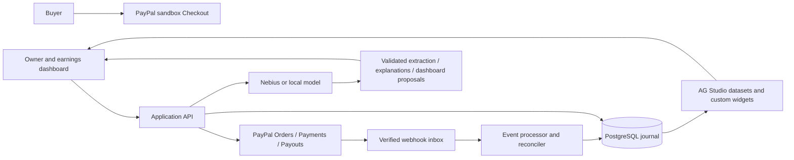

# CreatorSplit — standalone build specification

Prepared: 3 November 2026. Intended audience: an implementation agent working in a separate project. This file is self-contained; the repository containing it is only its delivery location. Do not import that repository's application, configuration, or assumptions into the new project.

Updated: 9 November 2026 after reviewing the supplied resources page, relevant sections of all four webinar transcripts, and the linked starter implementation. See the review record in section 17. Webinar captions are auto-generated; use current documentation and installed types for exact API names and commands.

## 1. Product and intended outcome

CreatorSplit helps a small creator collective agree on revenue shares, trace each collaborator's earnings to actual sales, and approve payments with a clear explanation of who receives what.

The complete demonstration is:

1. Paste a collaboration agreement.
2. AI proposes collaborator shares with supporting excerpts and flags ambiguities.
3. An owner reviews and activates the agreement.
4. A buyer purchases a digital product through PayPal sandbox Checkout.
5. An AG Studio dashboard shows the sale flowing into collaborator balances.
6. Ask, “Why does Maya have $30 available?” The assistant answers from recorded transactions and the approved agreement, with clickable evidence.
7. Ask, “Create a dashboard showing unpaid earnings by collaborator.” The agent changes the actual AG Studio dashboard.
8. The owner reviews a payout preview and explicitly approves it.
9. Actual PayPal sandbox payout item results update the dashboard and audit trail.

Primary sponsor target: Best Use of AG Grid. The distinctive feature is a financial dashboard that users can interrogate and reshape through an agent, with every displayed amount traceable to deterministic calculations.

Recommended secondary target: Best Use of APIMatic, through genuine use of its PayPal Context Plugin during development. This complements the dashboard work without adding another runtime AI provider. Record its actual contribution for the submission.

## 2. Decisions already made

| Decision | Specification |
| --- | --- |
| Payment environment | PayPal sandbox only. |
| AI default | Nebius Token Factory. The user confirmed their credits are Token Factory / former AI Studio credits. |
| Local AI alternative | Ollama; support the same application interface with a local model. LM Studio is an optional compatible alternative. |
| AI responsibilities | Agreement extraction, grounded explanations, and permitted dashboard operations. |
| Money responsibilities | Application code validates shares and calculates all balances, allocations, refunds, and payout amounts. |
| Payment structure | One merchant receives Checkout payments; separate approved Payouts distribute earnings. |
| Scope | One collective, one digital product, three collaborators, USD, one owner. |
| Distribution basis | Gross captured sale revenue. Merchant processing and payout fees are borne separately by the collective operator. |
| Sponsor UI | AG Studio with custom widgets and agent integration; an isolated AG Grid table is insufficient for this product's intended showcase. |
| Delivery | Runnable application, tests for financial invariants, setup documentation, and a short recorded end-to-end demo. |

This prototype is a revenue-sharing application. It does not implement PayPal marketplace split settlement, escrow, or automatically sweep a buyer's payment into multiple recipient accounts. The internal amount owed to creators is not a claim that the merchant has an equal available PayPal balance. The operator needs sufficient sandbox funds for distributions and fees.

## 3. MVP boundaries

### Required

- One configurable collective with three collaborators and manually configured sandbox payout recipients.
- A product with server-owned USD price and an active, versioned split agreement.
- Agreement entry through pasted text or a UTF-8 `.txt` file, capped at 12,000 characters.
- A live AI extraction call, editable review screen, evidence excerpts, and explicit activation.
- Real sandbox order creation, buyer approval, server-side capture, and verified webhook ingestion.
- An append-only earnings journal, deterministic allocation, and an audit trail.
- AG Studio dashboard with at least three custom widgets, linked filtering, and saved layouts.
- Live AI explanations and dashboard creation/editing using constrained tools.
- Owner-approved real sandbox payouts and item-level reconciliation.
- Full-refund handling, including a refund after a collaborator has already been paid.
- A visible distinction between actual sandbox activity and seeded demonstration data.
- A hosted configuration using Nebius and a documented local configuration using Ollama.

### Deferred

- Marketplace seller onboarding, multiple merchant accounts, currencies, FX, tax calculation, shipping, subscriptions, automated royalties, and production payments.
- PDF/OCR ingestion, document signing, legal interpretation, and enforcing a real-world contract.
- Complex agreements with recoupment waterfalls, minimum guarantees, expenses, or date-dependent tiers.
- User-triggered partial refunds. If a partial refund appears externally, place the affected balance on review hold until explicitly reconciled; do not guess the adjustment.
- Autonomous payouts, AI-created payout destinations, arbitrary SQL, and model-generated executable dashboard code.
- Full multi-tenant account management. A single-owner sandbox demo and read-only collaborator views are enough.

Do not add deferred features before the complete MVP journey works.

## 4. Users, screens, and interaction

### Owner

Can edit product settings, review extracted agreements, activate a new version, inspect all earnings, approve payouts, and initiate full refunds. Use a real server-side authenticated owner session. Configuration changes and payment mutations require that session, request validation, and CSRF/origin protection appropriate to the chosen framework.

### Collaborator

Has a read-only view of their agreement share, earnings, adjustments, and payouts. For the demo this may be a clearly labeled view switch available to the owner; do not present it as completed multi-user authorization.

### Buyer

Sees a public product page and PayPal sandbox Checkout. They cannot choose prices, collaborator allocations, or payout destinations.

### Required screens

| Screen | Behavior |
| --- | --- |
| Overview | Revenue, outstanding earnings, payout reservations, paid totals, and exceptions. |
| Agreement review | Source text alongside proposed shares; excerpt highlighting; validation and ambiguity messages; activate button. |
| Product checkout | Product description, server-owned price, sandbox labeling, and payment completion state. |
| Earnings workspace | AG Studio dashboard, custom widgets, transactions, filters, and assistant sidebar. |
| Payout review | Immutable preview of recipients, amounts, source balances, and currency; explicit owner approval. |
| Activity | Timeline of agreement activation, captures, allocation entries, payout state changes, refunds, and AI-assisted changes. |

Use a consistent color per collaborator. Display amounts in clear currency formatting, table headings with units, and status text alongside color. Empty, loading, error, processing, and retry states must be designed. Preserve keyboard navigation and visible focus. Never label an API-accepted payout as successfully paid until its individual item status confirms success.

## 5. Suggested implementation architecture

Use the official [PayPal + AG Studio boilerplate](https://github.com/paypaldev/hackathon-paypal-ag-grid-boilerplate) as the default starting point in an empty destination project. It is a Next.js application. Inspect its license, commit, lockfile, and current dependencies before adopting code; retain attribution. Reuse a suitable existing stack if the destination already has one. The starter supplies a dashboard, not CreatorSplit's agreement, collection, ledger, or payout workflow.

| Layer | Default |
| --- | --- |
| UI | Next.js App Router, React, TypeScript, AG Studio; retain the starter's styling approach. |
| Server | Next.js Route Handlers in the Node runtime, with a separately runnable durable worker. |
| Storage | PostgreSQL, checked-in SQL migrations, transactional writes, and unique constraints. |
| Validation | One shared runtime schema system, such as Zod, for request and AI output validation. |
| AI transport | Server-side OpenAI-compatible Chat Completions adapter; provider capabilities explicit in configuration. |
| Background processing | Small worker or durable DB job/outbox processor for webhook processing and payout reconciliation. |
| Tests | Unit/integration tests for ledger and provider boundaries; browser tests for the complete user journey. |

Pin actual dependency versions after inspecting current official docs and getting the starter to compile. Avoid inventing AG Studio methods from this spec: exact SDK calls must be verified against the installed version.



The database is the source of application financial state. Model output is never the source of truth for an amount owed or a payment status. Use DB transactions and row locks to serialize competing balance reservations; see PostgreSQL's [transaction](https://www.postgresql.org/docs/current/transaction-iso.html) and [locking](https://www.postgresql.org/docs/current/explicit-locking.html) documentation.

Suggested modules: `agreements`, `allocation`, `ledger`, `paypal`, `payouts`, `ai`, `dashboard`, `auth`, `jobs`, and `fixtures`. Keep external-provider adapters separate from business rules.

### Adapting the starter

| Starter area | CreatorSplit change |
| --- | --- |
| `lib/paypal.ts` | Reuse suitable server transport/authentication; add the explicit order, capture, refund, and payout operations required here. |
| `lib/dashboard-data.ts` | Replace general merchant reporting with views derived from the CreatorSplit journal. Do not require unrelated product, subscription, or invoice datasets. |
| `app/dashboard/studio` | Supply creator-specific datasets, custom widgets, theme, reports, and agent configuration. |
| Browser report persistence | Replace the starter's localStorage persistence with authenticated, collective-scoped layout storage. Financial state always stays in PostgreSQL. |

These paths are from the [starter documentation](https://github.com/paypaldev/hackathon-paypal-ag-grid-boilerplate). Its OpenAI adapter and server route need a separate provider migration described in section 11. The money domain must use the integer parsing and arithmetic in section 7, including when adapting display-oriented starter code.

### Tools for the implementation agent

- **APIMatic Context Plugin for PayPal:** use it to help implement and review the TypeScript Server SDK integration. The webinar identifies Orders, Payments, Vault, Subscriptions, and Transaction Search coverage; verify current coverage, and use official Payouts documentation for distributions. The sponsor page says PayPal context needs no additional APIMatic credentials. Follow the current [sponsor setup guide](https://paypalaihackathon.devpost.com/details/apimatic).
- **PayPal AI Toolkit:** optionally use its integration guidance, diagnostics, and sandbox tools while building. Follow the current [official repository](https://github.com/paypal/AI-Toolkit); do not copy installation commands from auto-generated captions.
- **PayPal Agent Toolkit / MCP:** these expose tools for agents and are distinct from the coding-assistant toolkit. CreatorSplit does not need to expose payment execution tools to its customer-facing assistant. Keep the approved server payment workflow in this spec.

These development aids do not replace the app's live Nebius/Ollama inference. Retain independent validation and tests for generated integration code. [APIMatic workshop, 15:02 onward](https://www.youtube.com/watch?v=zRWixN68tDg&t=902s), [PayPal tooling distinction, 23:58 onward](https://www.youtube.com/watch?v=FFJfCW9z3Do&t=1438s).

## 6. Agreement extraction and activation

The owner manually creates the collaborator roster and payout recipients first. The model receives collaborator IDs/display names, not recipient email addresses or credentials.

Example agreement:

> For sales of the Creator Toolkit, Alex receives 50%, Maya receives 30%, and Jordan receives 20% of gross revenue. The collective operator covers payment processing and payout fees separately.

Proposed output shape:

```ts
type AgreementDraft = {
  revenueBasis: "GROSS" | "UNSUPPORTED" | "UNSPECIFIED";
  shares: Array<{
    collaboratorId: string;
    basisPoints: number; // integer; 5000 = 50%
    sourceExcerpt: string;
  }>;
  ambiguities: string[];
  unsupportedClauses: string[];
};
```

Validation must verify known collaborator IDs, unique collaborators, shares between 0 and 10,000 basis points, exact excerpts present in the submitted source, and a total of exactly 10,000. Reject unsupported revenue bases or unresolved clauses. Do not normalize 95% into 100%, infer a missing creator, or invent an allocation to make a document valid.

Malformed model output gets one bounded repair attempt with validation errors. An incomplete or ambiguous agreement should produce a reviewable result, not a fabricated answer. The owner can edit proposed shares and explicitly record a clarification; store that clarification separately from AI-extracted evidence.

Activation creates an immutable agreement version with the source hash, approved shares, owner, timestamp, clarifications, and model/provider used for extraction. Orders pin the agreement version at creation. Later agreement changes only affect new orders. Already approved versions and historical allocations remain unchanged.

## 7. Financial rules and journal

### Amount representation

- Store USD amounts as integer minor units in PostgreSQL `BIGINT`.
- Use integer/BigInt arithmetic in the allocation domain. Serialize minor units as decimal strings in JSON to avoid loss of precision.
- Parse PayPal decimal amount strings without binary floating-point conversion.
- The product is digital and has no shipping, tax, or tips in the MVP.
- Allocate gross completed captures. Show provider fees separately where available, without reducing creator entitlements. Make this gross-sharing policy visible in agreement review and payout review.

### Allocation algorithm

For each collaborator, calculate `floor(amountMinor * basisPoints / 10000)`. Distribute the remaining cents in descending order of fractional remainder, breaking ties by stable collaborator ID. The result must sum exactly to the original amount.

Examples:

| Sale | Alex 50% | Maya 30% | Jordan 20% |
| --- | --- | --- | --- |
| $100.00 | $50.00 | $30.00 | $20.00 |
| $10.01 | $5.01 | $3.00 | $2.00 |

Store each allocation with its capture ID and pinned agreement version. A unique constraint must prevent more than one allocation for the same capture and collaborator. Server-side capture responses and webhook processing must call the same idempotent capture-ingestion function.

### Balances

Maintain an append-only creator earnings journal with at least these entry types:

- `SALE_ALLOCATION`: increases entitlement.
- `REFUND_REVERSAL`: reduces entitlement, referencing the original allocation.
- `PAYOUT_SETTLED`: reduces outstanding entitlement after confirmed item success.
- `PAYOUT_RETURNED`: restores the previously settled amount after authoritative confirmation of return.

Payout reservations are separate durable records. For each collaborator:

```text
outstandingMinor = sum(signed earnings journal entries)
reservedMinor = sum(active payout reservations)
availableMinor = max(0, outstandingMinor - reservedMinor)
```

Display a negative outstanding balance explicitly as an adjustment to be recovered from future earnings; do not hide it by showing only zero available. A payout preview cannot reserve a negative or zero amount. These are revenue-sharing records, not a full general ledger or a PayPal account-balance service.

### Refunds and reversals

A completed full refund reverses the exact stored sale allocations, preserving the original rounding. A refund before payout reduces availability. A refund after payout may produce a negative outstanding balance. It does not magically reverse an already delivered payout; subsequent earnings offset that adjustment.

Refund requests and payout approvals acquire the same affected balance locks. Block new payout approvals while an unresolved refund or other financial exception affects the balance. If an external refund arrives after a payout has already been submitted, reconcile both operations and surface any resulting negative balance.

An owner-requested refund must be deferred while any overlapping payout reservation is queued, dispatching, pending, or otherwise unresolved. Return a clear conflict explaining which payout must resolve first. Make this decision under the same locks used to claim a dispatch job, so approval followed by a queued job cannot race a refund request. Once the payout resolves, the owner can request the refund and the normal adjustment policy applies. External PayPal refunds cannot be deferred by this application: on ingestion, cancel any affected batch that is still wholly undispatched and release its reservations atomically; if dispatch has already begun or its result is unknown, reconcile it and record any resulting debt. A canceled batch requires a fresh preview and approval before other recipients are paid.

Partial refunds, unknown captures, unsupported currency, mismatched totals, or ambiguous provider states must enter a visible reconciliation queue and hold affected payouts. Resolve real provider state before appending adjustments. Historical entries are never overwritten to make totals match.

## 8. PayPal integration

Use server-side OAuth credentials and the sandbox API host. The browser receives only the public client ID and application order references. The backend owns price, product, currency, and agreement version.

### Sandbox setup and diagnosis

1. In the Developer Dashboard, select Sandbox and create clearly named business-merchant and personal-buyer accounts. For this USD demo use compatible account regions/currency. Add the three separate creator recipients required for Payouts.
2. Create a Merchant REST app attached to the intended business account. Keep its credentials in server configuration. The developer login manages test accounts; the generated sandbox account logins are used at the sandbox site to inspect buyer/merchant activity.
3. Register the reachable HTTPS webhook URL under that same sandbox app and save its webhook ID. Update the registration if a development tunnel URL changes.
4. Run a real checkout and inspect both sides of the transaction. Then exercise cancellation, refund, and payout failure handling. In Developer Dashboard logs, select the correct app and date range before diagnosing missing requests/events.

This runbook follows the [sandbox walkthrough, 25:35 onward](https://www.youtube.com/watch?v=FFJfCW9z3Do&t=1535s) and [sandbox setup guide](https://github.com/paypaldev/getting-started-with-paypal-sandbox). Transaction Search is optional for reconciliation; enable its app capability only if used and allow for propagation.

Cache OAuth tokens using the returned `expires_in` with an expiry margin. On an authentication-expiry response, refresh once and retry with the same operation identity where safe; never retry indefinitely. Do not hard-code the webinar's approximate token lifetime. [PayPal authentication](https://developer.paypal.com/api/rest/authentication/).

### Collection

1. Create an application order with a pinned agreement version and expected amount.
2. Create a PayPal order using Orders v2 and persist the provider order ID.
3. Let the buyer approve through the documented PayPal checkout experience.
4. Capture server-side and verify expected order, payee, currency, amount, and completed status.
5. In one transaction, record the capture and its collaborator allocations.
6. Update the dashboard and show the actual sandbox capture reference.

Retry payment operations using stable identifiers where the endpoint supports them; do not create a new business operation because a network response was lost. PayPal's `PayPal-Request-Id` support and retention are endpoint-specific. [Orders](https://developer.paypal.com/api/orders/v2), [Payments](https://developer.paypal.com/api/payments/v2), [idempotency](https://developer.paypal.com/api/rest/reference/idempotency/).

### Webhook inbox

Verify signatures using PayPal's documented method and configured webhook ID. Persist verified messages durably with unique event IDs, then acknowledge receipt; a worker can process them after acknowledgment. Preserve enough transmission information for diagnosis. Invalid messages cannot update balances. Redeliveries and out-of-order events must be safe.

Subscribe to the current documented capture, refund, and payout item events needed by the implementation. Read event names from official docs. Simulator events are test fixtures, not proof of a real sandbox transaction. [Webhook guide](https://developer.paypal.com/api/webhooks/overview).

### Distributions

Use Payouts v1 for distributions after explicit owner approval. Perform an early sandbox access test before building the full payout UI. Set up a Merchant REST app with a sandbox business sender and separate sandbox personal recipient accounts. Confirm sender funding and recipient configuration. Sandbox success does not establish production Payouts activation. [Account setup](https://developer.paypal.com/payouts/use-payouts/set-up).

1. Generate an expiring payout preview from current balances and configured recipients.
2. Store amounts, recipient snapshots, currency, balance revision, preview hash, and owner.
3. On approval, lock affected balance rows, revalidate the preview, reserve funds, and create a durable dispatch job atomically.
4. Submit the persisted payout batch outside the DB transaction. Reuse its stable `sender_batch_id` and persisted per-item sender IDs when retrying the same attempt.
5. Persist provider batch and item IDs. An accepted batch becomes pending; it is not evidence of payment completion.
6. Reconcile every item's authoritative result through verified webhooks and provider status queries.
7. On confirmed success, append one settlement entry and release the reservation atomically.
8. On confirmed terminal failure/cancellation, release the reservation without reducing earnings. Unknown, pending, held, or unclaimed states keep reservations until resolved.
9. If a payout returns after settlement, append a distinct return entry once. If a returned/refunded outcome is observed before a local settlement entry exists, release the reservation without adding an earnings credit. Mark the item terminally returned so a later stale success event cannot debit it. Confirm conflicting events against the provider's current item details; do not order financial effects solely by delivery time.

A retry after a genuinely terminal failure is a new approved attempt for the unresolved item only; retain a link to the previous attempt. Never resend successful recipients just because another item failed. Keep a reconciliation hold when an API timeout leaves the outcome unknown. [Payouts reference](https://developer.paypal.com/api/payments.payouts-batch/v1).

Claim the dispatch job and transition its persisted attempt to `DISPATCHING` under the same balance locks used by refund processing, then release the transaction before the network call. Enforce the refund policy above on both code paths. A crashed worker's lease can be recovered, but recovery reuses the same provider operation identity and reconciles first when acceptance is uncertain. Respect the provider's duplicate-detection retention period; an old unresolved attempt must enter manual review rather than being blindly resubmitted after that window.

Use direct capture/payout retrieval and verified webhooks for the immediate experience. Do not wait for Transaction Search to populate the live dashboard. Resolve the provider's actual item-state vocabulary, including returned/refunded outcomes, into tested application transitions; preserve raw provider state for audit. [Payout processing states](https://developer.paypal.com/payouts/payment-processing/).

If Payouts access is unavailable, show that blocker honestly and continue building collection, ledger, AI, and dashboard. A simulated payout adapter may support tests, but does not satisfy the real-payout acceptance criterion and must not be presented as actual PayPal activity.

## 9. Data model

Each entity has an internal ID and timestamps. Scope queries by collective even though only one collective is seeded. Use foreign keys and database uniqueness for correctness.

| Entity | Essential fields / constraints |
| --- | --- |
| Collective | Name, owner identity, currency, financial revision. |
| Collaborator | Collective ID, stable display identity, protected payout recipient configuration. |
| Product | Collective ID, title, price minor units, currency, active agreement version. |
| AgreementVersion | Version, status, source text/hash, approved basis points, evidence, model metadata, approved by/at. |
| Order | Product, agreement version, expected amount/currency, unique PayPal order ID, state. |
| Capture | Unique PayPal capture ID, order, amount/currency, provider status, confirmed timestamp. |
| JournalEntry | Collaborator, signed amount, type, source/provider reference, original allocation reference where applicable; unique business-effect key. |
| PayoutBatch | Preview/hash, approval, stable sender batch ID, provider batch ID, dispatch/reconciliation state. |
| PayoutItem | Batch, collaborator, amount, recipient snapshot, stable sender item ID, provider item ID/status, active reservation. |
| Refund | Capture, requested/confirmed amount, provider refund ID, state, reconciliation hold. |
| WebhookEvent | Unique provider event ID, verification result, payload, processing state, error/retry count. |
| Job | Durable job key/type, payload, claim/lease, attempts, next run time, outcome. |
| DashboardLayout | Owner, schema version, validated AG Studio layout configuration. |
| AIRun | Provider/model, task, input hash, prompt version, latency, validation result, evidence references. |
| AuditEvent | Actor, action, entity, timestamp, before/after references and source event. |

Sensitive source agreements and recipient data must not be copied into routine logs. Journal entries and audit references are immutable; corrections are additional entries.

## 10. AI provider options and recommended setup

### Default: Nebius Token Factory

The user has Token Factory credits. Use that service directly for the hosted demo; GPU provisioning is unnecessary for this path. Verify remaining credit, expiration, and applicable model billing in the user's account without requesting secrets in chat.

Nebius offers an OpenAI-compatible Chat Completions endpoint. Start by evaluating `Qwen/Qwen3-30B-A3B-Instruct-2507`, which is listed in official Nebius material. Verify exact availability and structured-output/tool support before locking the model; keep the model ID configurable. [Quickstart](https://docs.tokenfactory.nebius.com/quickstart), [model options](https://nebius.com/services/token-factory/models/qwen-models-inference), [billing](https://docs.tokenfactory.nebius.com/other-capabilities/billing).

Nebius documents JSON-schema output and tool calling, with capabilities varying by model. Validate schema and business rules on the server even when constrained output is enabled. [Structured outputs](https://docs.tokenfactory.nebius.com/ai-models-inference/json), [function calling](https://docs.tokenfactory.nebius.com/ai-models-inference/function-calling).

### Local alternative: Ollama

Use Ollama's local OpenAI-compatible endpoint. `qwen3:8b` is an initial evaluation candidate, not a guarantee of acceptable quality or latency on the user's hardware. Check memory and measured performance before choosing a model size. The model must run actual inference; canned responses are only test fixtures. [Compatibility](https://docs.ollama.com/api/openai-compatibility), [local structured output](https://docs.ollama.com/capabilities/structured-outputs).

For a fully local demonstration, run both the application backend and model on the same machine and provide reproducible instructions. PayPal webhooks still require a reachable HTTPS endpoint or a documented development tunnel. A deployed backend's `localhost` is the deployed server, not the developer's laptop. For an always-available hosted demo, Nebius is the simpler default.

LM Studio is an optional desktop alternative at `http://localhost:1234/v1`, with documented JSON-schema support. Do not build a separate UI or business workflow for it. [LM Studio structured outputs](https://lmstudio.ai/docs/developer/openai-compat/structured-output).

### Provider interface

```ts
interface CreatorSplitAI {
  extractAgreement(input: AgreementInput): Promise<AgreementDraft>;
  answerWithEvidence(input: EvidenceQuestion): Promise<EvidenceAnswer>;
  planDashboardChange(input: DashboardRequest): Promise<DashboardChange>;
}
```

Keep transport, schema, and tool capabilities inside the provider adapter. Prefer native schema/tool support where it works. If a local model cannot reliably emit tool calls, it may produce a validated dashboard-plan schema that the app translates into a small allowed set of operations. Label this as the app's custom agent implementation; do not claim an untested built-in provider integration.

Never silently send an agreement to another provider on failure. Return a clear error and preserve the owner's draft. Use a 45-second initial request timeout, one schema-repair retry, and explicit upper bounds on tokens, prompt size, and tool steps. Tune those values from measured demos.

## 11. Grounded assistant and AG Studio showcase

Register the earnings datasets, custom widgets, and permitted actions using the installed AG Studio APIs. Implement a custom backend agent/provider bridge as required by the actual Studio Agent Framework. All provider API keys stay server-side.

The current official framework documentation describes `AgStudioAiModule`, `createAiHarness`, and an `AgLlmAdapter`; verify these against the version installed in the new project. Implement the adapter's synchronous `executeTurn` response-handler contract and translate streaming events, messages, tool schemas, tool results, cancellation, and completion through the backend to Nebius Chat Completions. Do not copy a Responses-API example unchanged into a Chat Completions integration. Studio executes its permitted dashboard tools; application financial operations remain separate. [Agent framework](https://www.ag-grid.com/studio/javascript/ai/), [direct LLM adapter](https://www.ag-grid.com/studio/javascript/ai-direct-llm-runner/).

### Concrete Nebius migration

The starter's [browser adapter](https://github.com/paypaldev/hackathon-paypal-ag-grid-boilerplate/blob/main/app/dashboard/studio/openai-adapter.ts) builds OpenAI Responses requests and decodes Responses streaming events. Its [server proxy](https://github.com/paypaldev/hackathon-paypal-ag-grid-boilerplate/blob/main/app/api/ai/responses/route.ts) forwards to `/v1/responses`. Changing only the API key or base URL is insufficient for the Chat Completions integration selected here.

Replace that pair with the application provider bridge. Translate conversation history, tool-call IDs/results, tool schemas, text deltas, errors, and final completion; propagate cancellation. Start with one allowlisted Nebius model and prove a real dashboard tool round trip before polishing the chat UI. Do not pass Responses-specific reasoning options blindly to Nebius or Ollama.

Replace the starter's [AI configuration](https://github.com/paypaldev/hackathon-paypal-ag-grid-boilerplate/blob/main/lib/ai.ts) with the `AI_*` configuration in section 13. Remove its fallback to an inherited `OPENAI_API_KEY`; provider selection must be explicit. Protect the proxy with the owner session, bounded input/output, model allowlist, and rate limits before deployment. The upstream host comes from trusted server configuration, never the request body.

### Dataset and report design

Create sources for collaborators, completed sales, allocations, journal entries, and payout items with explicit IDs, field descriptions, currency units, and relationships. Document each source's row meaning. A sale joined to three allocations must not triple its gross revenue: supply server-computed totals or measures at the correct row level, and verify them against the journal. AG Studio formulas may support visual analysis; they do not calculate payout entitlements.

Provide three saved default reports—Overview, Creator earnings, and Payout exceptions—using the same underlying data and widgets. Expose view/edit, undo/redo, save, and reset controls. Preserve report state independently of financial records. This applies the webinar's [data model](https://www.youtube.com/watch?v=LGfG44i1Fj8&t=1586s) and [report-state walkthrough](https://www.youtube.com/watch?v=LGfG44i1Fj8&t=1918s) to CreatorSplit.

### Required custom widgets

1. **Revenue flow:** sale → agreement version → collaborator allocation, with selectable creator lanes and exact amounts.
2. **Creator balance card:** earned, refunded, reserved, paid, returned, and currently available values, with an evidence drill-down.
3. **Payout timeline:** per-item status and reconciliation progress, connected to underlying journal events.

Also include an AG Grid transaction/evidence table and a chart of earnings over time. Let owners rearrange, resize, and save layouts. Implement genuine linked filtering so selecting a collaborator narrows the relevant widgets and table. A reset returns to a polished default layout without resetting financial data.

Use Studio's built-in grid/chart widgets and ordinary React/SVG for the custom visuals. Register React custom widgets with the documented `createWidgets` / `AgWidgetDefinition` API, including both `formatShape` and `ai` metadata so the agent can configure them. Avoid embedding separately licensed enterprise grids/charts inside custom widgets unless those licenses are available. AG Studio's license covers its built-in components; custom use of other enterprise components has separate licensing requirements. [Custom widgets](https://www.ag-grid.com/studio/react/custom-widgets/), [licensing](https://www.ag-grid.com/studio/react/enterprise-licence/).

The AG Grid presenter explicitly said a missing license key would not be penalized in hackathon judging and described a 45-day trial. Treat that as event-specific judging guidance, not a commercial license. Obtain a trial where available, record its expiry, and verify the actual demo remains usable through judging. [Webinar clarification, 25:58–26:30](https://www.youtube.com/watch?v=LGfG44i1Fj8&t=1558s).

### Assistant actions

Allowed read tools: `getAgreement`, `getCreatorBalances`, `listSales`, `listJournalEntries`, and `getPayoutStatus`. These are application tool names, not claims about existing AG Studio SDK methods.

Allowed dashboard operations: create a widget from an allowlist, set validated filters, move/resize widgets, rename a dashboard, and explain a selected row. Preserve an undo path for layout changes. Tools cannot change agreement shares, recipient details, product prices, payout approval, or payment execution.

For explanations, the server calculates figures first and supplies a compact evidence bundle with immutable IDs, amounts, and time range. The model explains that bundle. Return evidence references alongside prose; clicking a reference opens the source transaction or agreement excerpt. Reject nonexistent references and render the trusted numeric summary from server data separately from generated text.

Implement this as a named **Creator Earnings Analyst** within the Studio assistant, with domain instructions and the allowed evidence tools. It should answer an earnings question and then create a useful report from the same authorized evidence. This gives the sponsor demo a concrete custom-agent capability beyond the starter's generic report builder. Include clickable prompt starters for the examples below.

Demo prompts:

- “Why does Maya have $30 available?”
- “Show unpaid earnings by creator and add a payout status widget.”
- “Filter this workspace to Jordan.”
- “Explain what changed after this refund.”

Treat source agreements and user messages as untrusted content. A sentence in an agreement asking the assistant to send money is document content, not an application instruction. Dashboard plans cannot contain arbitrary code or SQL.

The sponsor specifically emphasizes custom widgets, visual polish, layout tools, and agent integration. Follow the licensing and demo-access guidance above. [Sponsor guidance and starter](https://paypalaihackathon.devpost.com/details/aggrid), [AG Studio quickstart](https://www.ag-grid.com/studio/react/quick-start/), [custom widgets](https://www.ag-grid.com/studio/react/custom-widgets/), [agents](https://www.ag-grid.com/studio/react/ai-agents/).

## 12. Application API contract

The paths below are proposed application endpoints. The implementation agent may adapt naming to the starter but must preserve their boundaries.

| Endpoint | Purpose |
| --- | --- |
| `POST /api/agreements/extract` | Owner submits source; returns validated proposal or reviewable errors. |
| `POST /api/agreements/:id/activate` | Owner explicitly approves an immutable agreement version. |
| `POST /api/orders` | Creates a server-priced application and PayPal order. |
| `POST /api/orders/:id/capture` | Captures the corresponding approved order idempotently. |
| `POST /api/paypal/webhooks` | Verifies and durably records provider events. |
| `GET /api/earnings` | Returns trusted totals and evidence references for a validated scope. |
| `GET /api/activity` | Returns paginated financial and audit events. |
| `POST /api/payout-previews` | Owner creates an expiring preview from eligible balances. |
| `POST /api/payout-previews/:id/approve` | Revalidates, reserves, and queues the immutable approved batch. |
| `GET /api/payouts/:id` | Shows each item's last reconciled state. |
| `POST /api/captures/:id/refund` | Owner initiates a full refund with persisted operation identity. |
| `POST /api/assistant` | Executes bounded read/dashboard agent interaction. |
| `GET/PUT /api/dashboard-layout` | Loads/saves validated versioned layout data. |
| `GET /health` | Reports service health without disclosing keys or account details. |

All mutation bodies use runtime validation and authenticated ownership checks where appropriate. Checkout approval does not imply owner access. Rate-limit public order creation and authenticated AI calls. Stale payout previews return a refresh-required response, not a silently changed payout amount.

All financial reads, agreement access, activity, payout details, layout retrieval, and assistant evidence tools also require the owner session and collective scope. Only the product page, buyer checkout flow, minimal health response, and signature-verified webhook receiver are public. Bind buyer order creation/capture/status access to a buyer session or signed order-scoped token. A public product response must not disclose agreement source text, recipient details, creator financial history, or service credentials.

## 13. Configuration and operating modes

Provide an `.env.example` containing placeholders only:

```dotenv
APP_URL=http://localhost:3000
DATABASE_URL=postgresql://<local-user>:<local-password>@localhost:5432/creatorsplit
SESSION_SECRET=<generate-locally>
OWNER_LOGIN_SECRET=<configure-outside-source-control>

PAYPAL_ENV=sandbox
PAYPAL_CLIENT_ID=<sandbox-public-client-id>
PAYPAL_CLIENT_SECRET=<sandbox-server-secret>
PAYPAL_WEBHOOK_ID=<registered-webhook-id>

AI_PROVIDER=nebius
AI_BASE_URL=https://api.tokenfactory.nebius.com/v1/
AI_MODEL=Qwen/Qwen3-30B-A3B-Instruct-2507
AI_API_KEY=<server-only-nebius-key>

# Local override:
# AI_PROVIDER=ollama
# AI_BASE_URL=http://localhost:11434/v1/
# AI_MODEL=qwen3:8b
# AI_API_KEY=ollama

AG_STUDIO_LICENSE_KEY=<configure-according-to-current-studio-docs>
DEMO_FIXTURES_ENABLED=false
```

These are application configuration names. Map them to the actual frontend build/server environment conventions without exposing server secrets. The starter reads its Studio license from `AG_STUDIO`; either explicitly map `AG_STUDIO_LICENSE_KEY` or retain the starter name consistently. Use the documented Studio client initialization. Provider keys must never use a `NEXT_PUBLIC_` prefix.

Production API hosts must be disabled in the MVP. Configure sandbox recipient identities outside public fixtures and restrict owner payout actions to those configured recipients. Provide a dedicated judge/demo login through the submission testing instructions; keep service credentials in server environment variables.

Local setup must include database creation, migrations, seed command, model setup, webhook routing, owner login setup, and worker startup. Hosted setup must keep the API, database, worker, and model reachable during judging, with clear recovery instructions.

## 14. Build order and verification checkpoints

| Phase | Deliverable | Exit check |
| --- | --- | --- |
| 0. Integration checks | Record starter commit; compile; verify Studio setup; prove Nebius extraction and one Studio tool round trip; check real sandbox capture and payout access. | Record actual results, tool/plugin usage, and blockers before committing to provider-specific UX. |
| 1. Domain | Schema, immutable agreements, allocation function, journal, balance calculation, fixtures. | Rounding, version pinning, and journal invariants pass. |
| 2. Collection | Product checkout, create/capture, webhook inbox, shared ingestion. | A real sandbox sale creates one and only one set of allocations. |
| 3. AI extraction | Provider adapter, schemas, evidence review, activation. | Clear agreements extract correctly; ambiguous ones cannot auto-activate. |
| 4. Sponsor dashboard | Custom widgets, linked filters, layout persistence, polished states. | Actual sale data updates all relevant widgets coherently. |
| 5. Assistant | Grounded read tools and constrained dashboard operations. | Answer cites real evidence; requested layout change operates on AG Studio. |
| 6. Distribution | Preview/approval/reservation, durable dispatch, item reconciliation, refunds. | Real sandbox payout succeeds once; failed/unknown cases preserve correct balances. |
| 7. Submission readiness | Clean setup instructions, provider options, browser verification, screenshots, video. | Another person can run the application and reproduce the main demo. |

Keep working through independent phases when credentials block one integration. Never replace a missing external integration with an unlabeled mock. Report a checkpoint as complete only when its stated exit check is demonstrated.

## 15. Acceptance tests

Financial tests are mandatory because errors change money movement. Prioritize these over implementation-mirroring UI tests.

1. Allocation sums exactly to the capture amount for ordinary sales, one-cent sales, awkward percentages, and the $10.01 example.
2. Invalid shares, unknown collaborators, conflicting clauses, unsupported revenue bases, and missing evidence cannot activate.
3. Activating version 2 does not change orders or sales pinned to version 1.
4. A capture response followed by repeated webhook delivery creates one financial effect.
5. Unverified webhooks and mismatched amounts/payees/currencies create no allocations.
6. Two concurrent approvals cannot reserve or pay the same available earnings twice.
7. A lost payout-submit response retains the original attempt identity and reservation until reconciliation.
8. Partial batch success settles successful items only; unresolved items remain visible and cannot be silently resent.
9. A returned payout restores the appropriate balance exactly once despite duplicate and out-of-order events. If return is observed first, no settlement debit means no restoration credit, the reservation is released, and later stale success has no financial effect.
10. A full refund before payout reverses exact allocations. A refund after payout creates a visible negative balance and blocks further payment until offset.
11. A partial external refund or unknown provider state creates a review hold instead of guessed ledger changes.
12. An assistant answer uses valid evidence IDs; a request to change payout recipients or execute a payment has no executable tool available.
13. Layout generation accepts only allowed widgets/filters, persists correctly, and can be undone.
14. Nebius timeout/invalid JSON returns a clear recoverable state. The source draft survives and no alternate provider is invoked silently.
15. The local-provider mode runs actual model inference through the same business validation. If hardware prevents local verification, document it as unverified.
16. Browser verification covers agreement → real checkout → evidence drill-down → agent-created widget → approved real payout.
17. Payout approval → queued dispatch → owner refund request returns a conflict while reserved. A concurrent external refund cancels a wholly undispatched batch or reconciles an already-dispatching attempt without duplicate movement.
18. Unauthenticated financial reads and assistant requests are denied; a buyer can access only their own checkout order and cannot retrieve agreement or recipient data.
19. Dashboard joins and creator/date filters preserve totals at the correct row level. A $100 sale with three allocations still reports $100 gross revenue, and clearing a filter restores the original totals.
20. The Studio adapter completes a real Nebius tool-call/result cycle and handles cancellation/error without hanging the chat. With Nebius selected, an unrelated `OPENAI_API_KEY` cannot cause OpenAI traffic.

Create an AI evaluation fixture set with at least ten agreements covering clear splits, spelling/name ambiguity, totals below/above 100%, gross/net ambiguity, unsupported tiers, and prompt-injection text. Require valid schema for accepted results and zero silent activation of unsafe/ambiguous proposals. Record model ID, latency, and outcomes; do not claim accuracy beyond the evaluated fixtures.

## 16. Demo dataset and video plan

Seed one product, “Creator Toolkit,” priced at $100, and Alex/Maya/Jordan with a proposed 50/30/20 split. Configure actual sandbox recipients separately. Optional historical sales should be visibly labeled fixture data, with payout disabled for fixture-derived balances. Keep live and fixture balance domains separate.

Target video length: about 2 minutes 45 seconds.

| Time | Show |
| --- | --- |
| 0:00–0:20 | The creator problem and agreement extraction with highlighted evidence. |
| 0:20–0:45 | Review and activate shares; complete a sandbox purchase. |
| 0:45–1:15 | Revenue-flow and balance widgets update; inspect a transaction. |
| 1:15–1:45 | Ask why Maya gets $30; show cited agreement and sale. Ask the agent to add an unpaid-earnings view. |
| 1:45–2:20 | Review payout recipients/amounts, approve, and show real item status. |
| 2:20–2:45 | Explain the completed loop and show the coherent custom dashboard. |

Record actual completion of asynchronous calls, editing waiting time if needed without implying an unconfirmed payout has completed. A short refund demonstration can replace another segment if it strengthens clarity.

## 17. Hackathon constraints and handoff deliverables

Verified on 3 November 2026:

- The rules permit an AI tool/model/platform of the entrant's choice alongside the PayPal sandbox. Nebius and local inference fit that provider-neutral wording; meaningful AI must be present in the product.
- On multiple entries, the rules say: “An Entrant may submit more than one Submission” and “each Submission must be unique and substantially different”. Sponsor/Devpost decide whether submissions satisfy that condition. A rebrand or minor variant should not be treated as a distinct entry.
- Prepare a public source repository with an open-source license, functional demo or complete run instructions, tool usage explanation, and a public YouTube demonstration under three minutes.
- Submission deadline: 12 November 2026, 20:00 UTC; 13 November 2026, 01:30 IST. Judging ends 15 December 2026, 16:00 UTC. Plan demo and license availability accordingly.

Official event sources: [rules](https://paypalaihackathon.devpost.com/rules), [requirements](https://paypalaihackathon.devpost.com/), [AG Grid resources](https://paypalaihackathon.devpost.com/details/aggrid). Recheck them before submission.

The implementation agent must deliver source, lockfile, migrations, seed data, `.env.example`, architecture notes, exact run commands, test results, model evaluation results, screenshots, and a demo script. README must distinguish verified integrations, fixtures, and remaining blockers. No real API keys belong in the repository.

### Sponsor submission evidence

For AG Grid, show the custom widgets, cross-filtering, saved reports, and Creator Earnings Analyst operating on actual sandbox-derived records. For APIMatic, keep a short build note with the plugin/version used, the integration task it helped with, relevant files, and verification results; answer the plugin question on the submission form truthfully. Installation alone is not evidence of substantive use. The webinar explains qualification at [22:00–22:36](https://www.youtube.com/watch?v=zRWixN68tDg&t=1320s). The current event page lists three APIMatic winners, each receiving $1,000 plus six months of Business subscription. [Prize listing](https://paypalaihackathon.devpost.com/).

### Supplied-resource review record — 8–9 November 2026

The resources page and related documentation had been consulted for the original spec. The four recordings were newly reviewed through accessible auto-generated transcripts and descriptions, focusing on the relevant sections below; this is not a claim of frame-by-frame video inspection.

| Resource | Reviewed material and resulting refinement |
| --- | --- |
| [APIMatic Context Plugins](https://www.youtube.com/watch?v=zRWixN68tDg) | Context purpose, SDK coverage, demonstration, and prize qualification; added development workflow and submission evidence. |
| [AG Studio payments dashboard](https://www.youtube.com/watch?v=LGfG44i1Fj8) | Sandbox, data model, reports, license clarification, and agent framework; made starter migration and custom-agent showcase concrete. |
| [Hackathon resources](https://paypalaihackathon.devpost.com/resources) | Rechecked resource hub and sponsor links; followed the actual PayPal/AG Studio starter and setup guides. |
| [Sandbox and AI Toolkit walkthrough](https://www.youtube.com/watch?v=FFJfCW9z3Do) | Tooling at 15:33–25:25 and sandbox/testing at 25:35 onward; added setup and diagnosis steps. |
| [Start building with PayPal](https://www.youtube.com/watch?v=ck_zyB66p_Y) | Provider choice, API tools, and AI Toolkit sections; confirms the distinction between coding aids and in-app agent tools. |

Nebius remains the hosted default and Ollama remains the local option. The event still permits an AI provider of the entrant's choice. These resources refine the implementation and sponsor presentation without requiring another paid model provider. [Current requirements](https://paypalaihackathon.devpost.com/).

## 18. Prompt to start the implementation agent

> Build CreatorSplit from this specification in the current destination project. Inspect applicable project instructions and existing code first. Treat the decisions and acceptance criteria here as the product contract. Use Nebius Token Factory as the default AI provider and retain an Ollama-compatible adapter. Start with the PayPal sandbox, AG Studio, and AI capability checks, then implement the complete end-to-end journey in the listed order. Keep financial calculations deterministic, agreements versioned, payouts explicitly approved, and provider events idempotent. Use actual documented APIs for the installed versions. Continue independent work when credentials block one integration and report that blocker precisely. Do not substitute unlabeled mocks for required integrations. Finish with reproducible setup instructions, meaningful verification, and the demo assets. This document's original containing repository is unrelated to the destination application.
