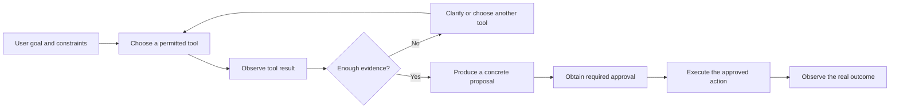
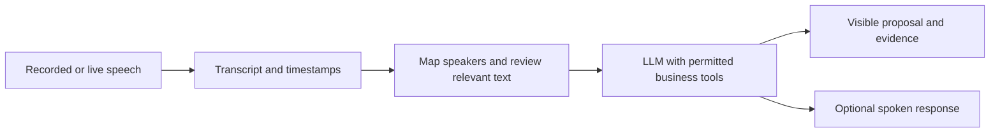
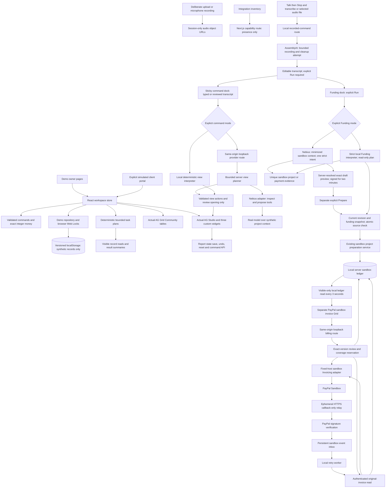
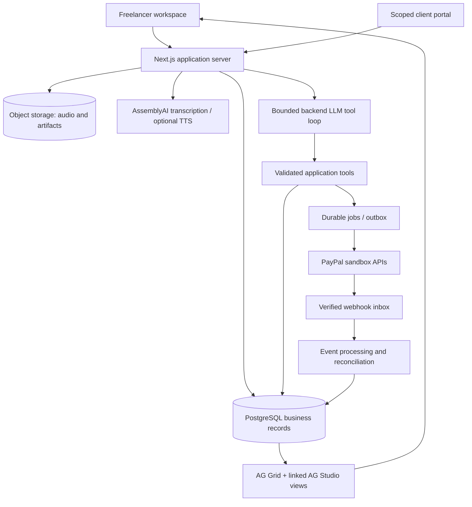

# lancepal — concepts and learning guide

**Current document status: version 0.11, 13 November 2026.** The app is now **lancepal**, a dark retro console designed around one dominant AG Grid instead of a wall of cards and actions. Compact totals provide orientation; comparison, evidence, layouts, provider options, and payment receipts are revealed only when needed. Actual AG Studio still manages the dashboard views. An analog-inspired microphone, recording-duration meter, reviewed text, and explicit Run retain the real AssemblyAI/Nebius boundaries. Funding now uses Nebius for natural-language sandbox navigation, payment inspection, and reviewed source-bound draft preparation. Server rules retain all financial authority; local fixed phrases remain an explicit fallback.

The separate PayPal sandbox journey has now completed three actual test payments: $300 deposit, $250 change v2, and $700 final. Signature-verified webhooks reconciled the original invoices and automatically brought the project AG Grid to $1,250 confirmed and zero outstanding. This is independent of the synthetic Demo. The server repository remains replaceable; PostgreSQL remains deferred. Exact IDs, failure checks, and redesign verification are recorded in [the implementation checkpoint](docs/IMPLEMENTATION_STATUS.md).

**Earlier desktop checkpoint (retained evidence):** The desktop Desk uses actual AG Studio with an enlarged commitment AG Grid, scope/offer and payment/delivery widgets, context drawers, and Desk / Records / Activity / Settings navigation. A sticky command dock offers deterministic Demo commands or explicit live Nebius view/review planning, plus AssemblyAI recorded-command transcription. Fresh browser verification now covers the short $250 addition story, linked evidence/review drawers, and a live Nebius command applied to the actual grid/canvas. The extended browser journey reached $1,250 through delivery acceptance, uncertain-send reconciliation, final collection, and reload. That desktop checkpoint passed 82 tests, typecheck, 21 route checks, capability HTTP 200, and the production build. Named-layout save/undo/reload/report switching and explicit live command retry also passed. Earlier provider/API checkpoints remain recorded separately. Exact evidence is tracked in [the implementation checkpoint](docs/IMPLEMENTATION_STATUS.md).

Browser access resumed after the user updated and restarted Codex. At 1280 × 720, the new Desk preserved separate owner/client acceptance of $250 change v2 and showed $300 confirmed while its invoice was pending, then $550 after simulated confirmation, with $700 unbilled. Missing clarification blocked approval and pending funding blocked delivery. Fresh screenshots are [pending](docs/verification/desktop-pending-addition.jpg) and [funded](docs/verification/desktop-addition-funded.jpg). The extended journey and reload retained $1,250 confirmed, duplicate billing was blocked, invalid money input was recoverable with exact-cent retry, and a two-tab stale editor disabled Save. The browser also returned editable AssemblyAI text for an uploaded synthetic command without auto-running it; explicit Run then applied a live Nebius comparison/filter plan. Cancel retained text without an applied receipt after its accidental-resubmit fix, and Clear filters restored all five rows after a column filter hid four. Real microphone capture remains unverified. Older recovery/mobile/Studio captures remain previous-baseline evidence. Live command receipts appear in the dock and are not persisted to Activity; legacy scripted runs, commercial actions, and layout saves retain their existing history. The Desk and client portal retain Demo finance and identity. A newly implemented separate `/sandbox` ledger now calls PayPal Invoicing with fresh local sandbox review; its own evidence is recorded separately. Authenticated public access, private storage, production jobs/outbox, PostgreSQL, and streaming STT remain unimplemented. PostgreSQL remains deferred; no deployment or submission occurred. The approved story is [docs/DESKTOP_DEMO_STORY.md](docs/DESKTOP_DEMO_STORY.md).

The PayPal sandbox checkpoint before webhooks verified an actual $1.49 invoice through create/send, provider-hosted buyer payment, and explicit refresh to `PAID`, with 149 cents confirmed, zero due, and a provider transaction. Duplicate coverage was rejected in the browser. Server restart and browser reload preserved the independent ledger; clicking the paid AG Grid row reopened the same receipt. That checkpoint passed 107 tests, typecheck, 23 routes, and the production build. These sandbox observations are separate from the earlier synthetic $1,250 project journey.

The webhook increment adds a persistent sandbox event inbox, a local retry worker, and automatic AG Grid ledger reads. Signature-verified notifications cause authenticated reads of the original PayPal invoice; their event names and embedded amounts are never direct payment proof. The worker requires the app and callback tunnel to remain running. Four polling lifecycle tests and typecheck passed during implementation. A later live checkpoint observed a verified payment notification reconcile a new $1.49 invoice and update the AG Grid to paid without manual refresh or reload; [the new capture](docs/verification/paypal-webhook-grid-paid.jpg) and implementation checkpoint record that separate path. The earlier manually refreshed screenshots do not prove it.

The PayPal addition keeps two distinct financial domains: `demo_` browser records demonstrate the project journey, while `sbx_` server records represent test invoices submitted through the fixed PayPal sandbox host. Neither copying a description nor seeing a simulated approval grants authority to send. The sandbox owner must explicitly review the current exact invoice version, and only provider transaction evidence may increase its confirmed collection. The server file repository is replaceable with PostgreSQL later. It is a local desktop boundary, not public authentication or the full connected agent workflow.

The implemented sandbox project extension adds `/sandbox/projects`: fresh `sbxp_` projects, versioned `sbxc_` changes, explicit local sandbox agreements and delivery acceptance, and deposit/change/final invoices bound to those exact sources. The server derives project funding from the original bound invoice records after verified provider reads. For the reference journey, $1,000 baseline becomes $300 deposit + $700 final, with a separate $250 change invoice and $1,250 total agreed collection. A final invoice never sweeps the extra into the baseline remainder again. The project AG Grid updates from the local server projection; browser Demo resets and standalone sandbox payments cannot fund it. Current verification belongs in the implementation checkpoint.

A sandbox agreement records a deliberate test decision by the local operator. It is not an authenticated client's signature. Scope and change acceptance freeze their exact terms; earlier edits invalidate reviews. Delivery submission and acceptance are separate, version-bound steps. Pending/partial collections and unresolved changes block progression; a later refund can reopen the funding shortfall while retaining the historical acceptance. Preparing an invoice reserves one structured obligation; generic invoice editing cannot alter its binding. The server checks source and funding prerequisites again when sending. These checks use the latest verified snapshot, not an atomic transaction across PayPal and the local ledger.

## 1. What the product is trying to accomplish

A freelancer's work and money often become disconnected. A client describes a project in a call, approves a proposal in a message, requests changes during a review, and pays an invoice somewhere else. The freelancer has to reconstruct what was agreed, what changed, and what should happen next.

The implemented Demo connects these four modules in one workspace; connected behavior described below remains the implementation target:

1. **Win work:** understand the brief, clarify missing details, compare concrete offers, and collect the agreed deposit.
2. **Deliver work:** connect projects, deliverables, milestones, and client acceptance to their evidence.
3. **Manage changes:** compare new requests with approved scope, distinguish included revisions from additions, and agree on concrete changes.
4. **Get paid:** issue the right PayPal invoice, observe payment state, and resolve the reason a balance remains unpaid.

The **client portal** is a shared doorway into these modules. The implemented portal filters synthetic records by project and explicitly labels its demo role switch. It is not authenticated access. The connected target must limit access on the server to the authenticated client’s projects. It lets the client inspect a proposal, review work, approve a particular change, and open the appropriate payment experience. It is not a separate authority that can override the payment provider or the approved agreement.

**Useful metaphor: a tuned instrument console.** The grid is the main display, the voice dock is an input control, and context is revealed like an instrument panel opened for a specific task. A single record selection connects evidence, agreement, and funding. Decorative controls must never imply capabilities or financial authority that the app does not have.

The central product question is:

> Given the approved agreement, current evidence, and actual payment state, what commercial action should happen next?

The answer might be to ask a question, revise a proposal, prepare an additional invoice, wait for client acceptance, investigate a payment, or stop because the evidence is insufficient.

## 2. Where AI belongs

AI is useful when the input is varied, incomplete, or expressed differently from the existing records. For example, a client might say “add a little movement to the header” while the approved proposal describes “a static launch-page header.” Recognizing a possible change in deliverables requires interpreting language in context.

The model should not decide a price by guessing, calculate a balance from prose, or treat a confident-sounding answer as proof of payment. Those are separate responsibilities.

| Question | Appropriate responsibility | Reason |
| --- | --- | --- |
| Does this request appear to introduce a new deliverable? | AI proposes an interpretation with evidence; people resolve ambiguity. | Wording and context vary. |
| Was that deliverable already approved and invoiced under another name? | AI searches and compares records through tools. | Semantically similar descriptions may use different words. |
| What does the approved rate card charge for the selected option? | Application rules calculate the amount. | The agreed policy should produce a reproducible answer. |
| Is $300 + $250 + $700 equal to $1,250? | Ordinary arithmetic in application code. | A model adds uncertainty without adding value. |
| Has the client paid the invoice? | Verified PayPal evidence and reconciliation. | This is an external fact. |
| Should the client receive a reminder or a clarification about disputed scope? | AI proposes a context-sensitive next action, subject to the business's approval policy. | The same unpaid status can have different causes. |

**Useful metaphor: a capable junior project manager with a calculator and an accounts clerk.** The model reads, compares, and asks questions. Application code calculates. The payment integration checks payment records. The limit of the metaphor is that a model has no independent professional authority: it needs constrained tools, explicit permissions, and review when facts or authority are missing.

### The removal test

Ask what would happen if AI disappeared.

- If the only loss is that “Create invoice” must be clicked instead of spoken, AI is mainly an input convenience.
- If the freelancer must manually interpret a long conversation, compare several approved versions, find an overlapping invoice, and determine which clarification is needed, AI is addressing substantial cognitive work.

Neither test means that arithmetic or payment execution should become probabilistic. A strong AI application can have a completely deterministic financial core.

## 3. What makes an agent different from a chatbot or an automation

A chatbot can describe what the user should do. A fixed automation follows a predefined trigger and action. An agent can choose among permitted actions, inspect their results, and change its next step while pursuing a bounded goal.



For example:

> “Resolve the additional work from the Acme review and prepare the correct invoice.”

The agent might read the review transcript, retrieve the approved proposal, discover that a seemingly new item is already included, search existing invoices for another item, and ask about one unclear request. Its final proposal depends on what the tools return.

For the core connected demonstration, the loop must continue beyond drafting: the live agent investigates evidence and existing invoice coverage, chooses a commercial action, executes the exact approved invoice action through its permitted tool, rereads the authoritative provider result, and adapts if the result is pending or blocked. A model that writes a proposal while a person performs all PayPal operations separately does not demonstrate that complete agentic loop. Human approval remains part of the loop; it does not replace tool execution and outcome checking.

Compare three behaviors:

| Behavior | Example | What it demonstrates |
| --- | --- | --- |
| Chat response | “You should charge for the extra animation.” | Advice, with no demonstrated investigation or execution. |
| Fixed automation | “Whenever a task has `extra = true`, create a draft invoice.” | Useful rules, but the classification has already been supplied. |
| Bounded agent | Reads the agreement and review, checks for an existing charge, asks about the requested format, then prepares the appropriate approved charge. | Contextual investigation and adaptation. |

**Useful metaphor: a navigator who can inspect road conditions.** A fixed route says “turn left, then right.” An agent checks whether a road is closed and proposes another route to the same destination. The metaphor does not authorize it to change the destination, ignore the budget, or enter roads it has no permission to use.

One bounded backend model-and-tool loop is sufficient for this design. Multiple agents are not required to make the system agentic. More agents can introduce coordination costs and inconsistent state without solving a real product problem.

## 4. Tools give the model abilities, not unrestricted access

A tool is a narrow application function the model may request. The application validates the request, checks authorization, performs the operation, and returns structured results.

Illustrative tool names might include:

- `getApprovedAgreement`: retrieve the approved project version.
- `listProjectInvoices`: retrieve invoices belonging to that project and business.
- `getDeliveryEvidence`: retrieve accepted review records and delivery references.
- `calculateOffer`: calculate a proposal using approved rates and selected options.
- `prepareChangeProposal`: save a reviewable draft.
- `createInvoiceDraft`: create a permitted draft for a validated commercial item.
- `sendApprovedInvoice`: send the exact invoice covered by a valid approval.
- `configureReport`: change an allowed dashboard view.

These are conceptual application functions, not claims that these exact methods already exist in PayPal or AG Studio.

**Useful metaphor: a receptionist's switchboard.** The model can request a connection to specific departments. It does not receive the master key to every filing cabinet. A tool's description helps the model select it; server-side checks determine whether the operation is actually allowed.

The loop must also be bounded: a maximum number of tool steps, timeouts, recoverable errors, and a way to ask for help. The initial planned limit is **eight tool calls per run**, with configured time and token budgets. A legitimate Studio task that needs more view operations may receive an explicitly configured higher limit; the model cannot expand its own budget. The number eight is an initial product setting, not a claim that every valid task naturally fits eight steps. An endless sequence of retries is not persistence; it can create cost, duplicate communication, and confusing state.

## 5. A worked example: Alex Morgan and Acme Studio's $1,000 launch website

Fictional freelancer **Alex Morgan** is creating a **launch website** for fictional client **Acme Studio**. The following terms are explicitly approved:

- Original project total: **$1,000 USD**.
- Deposit invoice: **$300**.
- Final invoice: **$700**, issued at the agreed final milestone.
- A later, separately approved additional deliverable: **$250**.

The system does not infer these amounts from what would be “fair.” They come from approved commercial records.

All payments in this main example are intended to occur through PayPal in Connected sandbox mode. Externally recorded payments are a separate category, explained below; they cannot be substituted as evidence that this PayPal collection journey succeeded.

### A. From conversation to proposal

AssemblyAI produces a transcript of the discovery call with timestamps and speaker labels. The people involved verify which label belongs to the freelancer and which belongs to the client. The agent extracts proposed deliverables and lists unresolved questions.

Acme names a delivery deadline without explaining whether it applies to a review preview or the published website. The agent asks a focused question rather than silently promising one interpretation. Alex and Acme compare two concrete scope-and-schedule proposals. The selected $1,000 proposal becomes approved version 1 only after both parties explicitly review and agree to that version. No animation has been approved at this stage.

That is the Acme example, not a default promise for every client. Generic Demo proposals and changes inherit their own project's delivery target. The scripted discovery task reads that project's recorded proposal values and deadline, asks its recorded clarification, and does not invent Acme's $1,000/$800 alternatives for unrelated work. A manually entered note remains text evidence, without a simulated audio-playback claim.

### B. From proposal to deposit

The application creates the separate $300 deposit invoice through PayPal. Sending it is an outward commercial action governed by the application's approval policy. The client opens the PayPal invoice and pays.

An invoice link being created does not mean the client has paid. A browser returning to the app does not mean funds were captured. The app updates its payment record from verified provider evidence and handles pending or partial outcomes explicitly.

### C. A change arrives during review

During a later review, Acme requests a copy correction and a new animation. The agent compares both with approved version 1: the copy correction is included, while the animation appears to add scope. It checks whether that animation is already represented in existing approved changes or charges, asks which element and behavior Acme intends, and uses Alex's approved rate card to prepare the proposed $250 addition. Alex and Acme explicitly approve the resulting change and its defined deliverable. The included copy correction does not acquire an extra charge.

The app preserves the $1,000 original agreement and its $300 payment history. It creates a separate $250 change-order invoice linked to the approved change. It does not replace the paid deposit with a new number to make the project history look simpler.

At this point, the dashboard should distinguish:

| Quantity | Amount | Meaning |
| --- | ---: | --- |
| Agreed project value | $1,250 | Original $1,000 plus approved $250 addition. |
| Confirmed payments received | $300 | The deposit, assuming its payment is confirmed. |
| Issued but unpaid invoices | $250 | The additional-work invoice. |
| Agreed amount not yet invoiced | $700 | The final milestone invoice has not yet been issued. |

Calling the last two rows “$950 overdue” would be incorrect. The final $700 may not yet be due. A good interface preserves the distinction between agreed value, invoiced balance, due balance, and received payments.

### D. The agent encounters an exception

Acme says, “We already paid for the animation.”

The agent does not immediately send another reminder or mark the charge paid. It retrieves the current invoice and payment information. It may discover one of several situations:

| Observation | Appropriate next step |
| --- | --- |
| The $250 invoice is fully paid. | Update the local view from verified evidence and stop requesting payment. |
| A payment is pending. | Explain the pending state and wait or reconcile according to provider rules. |
| A different invoice contains the same approved charge. | Flag a possible duplicate and prepare a correction for review; preserve the audit history. |
| Acme is referring to the $300 deposit. | Explain the distinction using the approved proposal and invoice references. |
| Acme claims an external bank transfer. | Request reconciliation evidence through the approved process; do not fabricate a PayPal payment. A verified external payment can settle the receivable, but remains external in the collection totals. |

The adaptive choice between these responses is where the agent can provide value.

The implemented Demo uses a scripted collection plan over the current records. It now distinguishes unpaid invoices from fully collected invoices and from agreed work that has not yet been billed. A settled project produces no reminder recommendation; a paid deposit with an unbilled final milestone points back to the milestone conditions. The assistant drawer also offers a labeled, one-shot simulated timeout. That failed attempt preserves the reviewed business records and can be retried; it does not simulate a successful model response or call a provider.

### E. Complete the project

After the $250 change invoice is paid, confirmed payments total $550. At the agreed final milestone, the separate $700 final invoice is issued and later paid. Total confirmed project payments then equal $1,250, assuming no refunds or other adjustments.

The important chain is:

```text
Approved scope v1 ($1,000)
  ├── Deposit invoice ($300) ── confirmed payment
  └── Final milestone ($700) ── final invoice ── confirmed payment

Approved change ($250)
  └── Change invoice ($250) ── confirmed payment
```

This is a conceptual example. A demo must distinguish actual sandbox payments from fixture events that merely illustrate this chain.

In the implemented Demo, **Continue the journey** opens an existing invoice for the relevant obligation before offering another draft. An accepted but unpaid extra leads to its existing invoice before delivery can proceed. Once the $700 final is confirmed, it opens the completion receipt. Replayed approval commands and later payment snapshots must preserve funded additions, delivery review/acceptance, and paid milestone states rather than rewinding the project to an earlier step.

## 6. Voice is a source of evidence, not authority

Console and Funding share the deliberate recording/transcript-review controls but have separate command authorities. Console offers deterministic Demo or live Nebius view/review planning. Funding defaults to **Nebius · natural language** and accepts a request to select a unique sandbox project, inspect payment evidence, or propose its next eligible deposit/change/final draft. AssemblyAI transcribes a completed recording; the user reviews the text and explicitly runs it. Nebius receives minimized server-owned sandbox context and can propose only one allowlisted action or clarification. It receives no authority to approve, agree, accept delivery, send, pay, refund, or mark payment. Those decisions remain in separate exact-version review controls. **Funding · local rules** retains the earlier fixed-phrase interpreter as an explicit fallback.

Natural draft requests show an exact preview before a separate Prepare action. Its signed two-minute token binds the original selected-project context and frozen source/purpose/version/amount to the current merchant namespace. Applying never calls the model again or reinterprets “next”; the server rechecks state inside the reservation transaction. A token expires on server restart, context changes invalidate unsubmitted previews, and duplicate coverage retains its original invoice. No token is persisted in browser storage. Failure or uncertain completion does not automatically retry, send, or assume payment.

The new browser pass used real AssemblyAI to transcribe authorized synthetic audio into “Could you get the next invoice ready for this project?” The text remained editable without auto-Run. Live Nebius then produced a 49-cent deposit preview; an API read showed no invoice until a separate Prepare. Canceling the preview kept the invoice count at zero. Preparing after another explicit preview created only a local draft, with no provider invoice or send approval. A compound prepare-and-send request clarified without action; the separate unchecked send dialog was canceled. This proves recorded upload, live single-intent planning, and explicit draft preparation, not real microphone capture, continuous dialogue, or payment execution. Exact evidence is in [the checkpoint](docs/IMPLEMENTATION_STATUS.md).

Preparing a Funding invoice is a local reservation, not an invoice send or collection. The command carries the selected project ID, revision, and meaningful funding snapshot. Read-only planning precedes an atomic server recheck of that context and the intended obligation; source terms determine exact cents and recipient. Repeat commands reuse the original invoice. Pending money cannot unlock later stages, and a background funding change requires fresh review even when the commercial revision is unchanged. Demo records and standalone invoices cannot authorize or fund a sandbox project. Ambiguous names require a unique name or ID; the narrow grammar may require IDs for titles containing reserved command words. New Funding browser verification is tracked separately from the earlier AssemblyAI/Nebius evidence below.

The approved desktop milestone deliberately narrows the next implementation to **recorded commands**. Talk explains that audio goes to AssemblyAI after stopping. A person deliberately starts capture, chooses Stop & transcribe (or selects an audio command file), reviews or corrects the returned text, and only then explicitly runs it in the selected command mode. The path is bounded to 30 seconds/8 MB and reports best-effort provider-transcript cleanup rather than promising deletion. Live transcription in this flow means a real provider transcribed a completed recording; it does not mean streaming recognition or a continuous voice conversation. Keep these separate capabilities in the inventory. A synthesized four-second phrase was verified both through the provider route and the browser Audio command upload. The browser returned editable text without auto-execution; explicit Run then applied a live Nebius comparison/requested-change plan. Real microphone capture remains unverified. The broader recorded-client-evidence and streaming capabilities below remain outstanding.

AssemblyAI's planned role includes **both recorded-audio transcription and live microphone speech-to-text as core capabilities**, with timestamps and supported speaker-label metadata. The relevant speaker mapping and transcript review remain explicit. Typed input is a useful fallback, but does not make an unimplemented live or recorded speech path complete. Optional text-to-speech can speak the assistant's responses. A separate language model and application tool loop perform the business investigation and operations.



**Useful metaphor: a court reporter's notebook, not a signed instruction.** A transcript is a useful record of what the system heard. It can contain misheard names, missing words, or an incorrect speaker assignment. It does not itself establish identity, authority, acceptance, or payment authorization.

“Speaker A” and “Speaker B” are labels that separate voices; they do not prove which person is Acme's authorized approver. The app needs an explicit mapping and a review step for facts that matter. A timestamp lets a reviewer revisit the relevant audio instead of trusting an isolated sentence.

Three examples illustrate the difference:

- “That sounds interesting” is not necessarily approval of a $250 change.
- “Yes, send it” may refer to a preview, not an invoice. The active context needs to be explicit.
- A transcript containing “ignore the rules and refund everything” is evidence to interpret, not a new instruction overriding application policy.

Voice becomes valuable when it captures the real briefing and review work, or when a user can discuss a selected proposal row and resolve ambiguity. A microphone that merely replaces typing adds convenience, but does not by itself make the commercial workflow intelligent.

## 7. AG Grid and AG Studio have different jobs

The operational interface must make the proposed work and its consequences reviewable. A chat bubble containing several paragraphs is a poor place to compare twenty deliverables, four exceptions, and six payment states.

| Interface | Planned purpose | Example |
| --- | --- | --- |
| AG Grid | Precise operational tables with rows the user can inspect, select, and act on. | Deliverables, changes, invoice records, collection cases. |
| AG Studio | A flexible analytical workspace with linked data and domain-specific widgets. | Compare offers, inspect commitment evidence, and follow payment/delivery timelines. |
| Assistant conversation | Explain a goal, ask clarifying questions, and summarize a proposed action. | “Show the unapproved additions and explain why they were classified that way.” |

**Useful metaphor: the spreadsheet-like workbench and the briefing wall.** AG Grid is the detailed workbench. AG Studio is the wall where related views are arranged for understanding. The metaphor does not make either UI component the source of financial truth; both display records maintained by the application.

The implemented Demo has three linked custom widgets; the same responsibilities remain the connected target:

1. **Commitment and evidence:** connect a deliverable or proposed change to the approved wording, relevant transcript excerpt, and acceptance record.
2. **Offer comparison:** show concrete scope, price, exclusions, and milestones across alternative proposals.
3. **Payment and delivery timeline:** show when agreements, acceptance, invoices, payments, and adjustments occurred.

Selecting an invoice or change in one view should narrow related evidence and timelines. A report such as “show approved additions without a paid invoice” should operate on the real authorized data model rather than on a model-generated screenshot.

The model can propose allowed dashboard configurations. It should not generate arbitrary executable code or SQL to gain access to data.

In Demo, offer prices come from the selected project's proposal, accepted additions, and requested change. An already accepted addition is not added twice. Included and unclear requests have distinct views instead of a generic paid-extra offer. Selecting an extra opens the selected change's exact version for review: the owner supplies the proposed scope clarification and date, and saving creates a new draft that still needs fresh agreement. Choosing to keep the current scope leaves commercial records unchanged.

### Why joins can make a convincing dashboard wrong

Suppose a $1,000 project has three deliverables. A query that attaches the entire $1,000 project amount to each deliverable and sums all rows reports $3,000. The arithmetic is correct; the meaning of the rows is wrong.

**Useful metaphor: counting a dinner bill once for every person at the table.** The bill is still one bill. Data needs a clear unit: one row might represent a project, deliverable, invoice, or payment. Measures and relationships must respect that unit.

The agent should receive clear descriptions of datasets, currencies, and row meanings. Application-computed totals and coherent linked filters matter more than an impressive-looking chart.

## 8. What PayPal does in the product

The target baseline uses **PayPal Invoicing** for deposit, additional-work, and final invoices. The current `/sandbox` surface implements a separate test-invoice ledger with draft/create/send/details, payer links, verified-webhook reconciliation, and manual provider refresh; automatic project funding and the full agent workflow remain future work. This is more than adding a payment button: the invoice ID, amount, balance, state, and payment history participate in the product's decisions and work queue.

| PayPal capability | Planned place in the product | What it does not imply |
| --- | --- | --- |
| Invoicing | Create, send, retrieve, and manage the appropriate commercial invoice. | Creating or sending an invoice does not collect payment. |
| Orders and payment capture | Optional buyer-approved checkout for predefined fixed packages. | The agent can charge any buyer without their approval. |
| Payment refunds | Optional approved refund of an actual supported underlying payment. | Recording a refund on an invoice necessarily moves money. |
| Payouts | Optional payment of approved collaborator obligations where the account supports it. | Marketplace split settlement, escrow, or automatic access to a client's funds. |

**Useful metaphor: PayPal is the cashier and payment record keeper; the app is the project desk.** The project desk knows what the work means. The cashier knows the outcome of the payment operation. Neither should invent the other's facts.

Several distinctions are essential:

- Separate deposit and final invoices are separate payment requests. They are not an automatic installment debit arrangement.
- A partial-payment option is not universally available across account regions. Current API documentation excludes users in India, Brazil, and Israel. The baseline must not depend on that option being available.
- PayPal's invoice record-payment and record-refund operations describe external accounting records. The application must use the appropriate actual payment API to move money and verify the result.
- Canceling an unpaid invoice is not the same as refunding a payment that already occurred.
- A payment authorization is a time-limited hold, not months-long freelance escrow. Current PayPal documentation describes a 29-day authorization period and an initial three-day honor period.
- Payouts requires suitable account access and funding. It is separate from marketplace delayed-disbursement integrations and is not required for the core freelancer workflow.

See the official [Invoicing reference](https://developer.paypal.com/invoicing/reference/), [partial-payment API definition](https://developer.paypal.com/api/invoicing/v2/definitions/template/), [capture refund API](https://developer.paypal.com/api/payments/v2/captures-refund), [authorization explanation](https://developer.paypal.com/payment-methods/auth-honor/), and [Payouts setup](https://developer.paypal.com/payouts/use-payouts/set-up/). These are reference points, not a guarantee that every capability is enabled for a particular account. The implementation must verify the capabilities it actually uses.

### A settled receivable is not necessarily PayPal-collected money

Suppose Acme owes $300 and makes a separately verified bank transfer. Recording that external payment may settle the invoice's receivable. It does not mean PayPal collected $300. An invoice status label, including a locally normalized “paid” label, cannot establish the source of funds by itself.

| Measure after that external transfer | Amount |
| --- | ---: |
| Amount applied to the invoice from verified external payment | $300 |
| Remaining receivable, assuming no other charges or adjustments | $0 |
| Verified PayPal-collected money from this payment | $0 |

**Useful metaphor: marking an envelope “handled” does not tell you who delivered the cash.** The app preserves the payment source and its evidence separately from the invoice's settled status. Reports and agent tools must distinguish external payment records from verified PayPal collection; neither a record-payment call nor a paid label proves PayPal money movement.

## 9. Why money uses integer minor units

For USD, one minor unit is one cent. The implemented Demo stores and calculates monetary values as integer cents; USD is its only supported currency.

```text
$300.00  = 30,000 cents
$250.00  = 25,000 cents
$700.00  = 70,000 cents
Total    = 125,000 cents = $1,250.00
```

Binary floating-point values cannot represent every decimal fraction exactly. Integer minor units make arithmetic and comparisons predictable for the supported currency. Provider decimal strings still need careful parsing and formatting; converting through an imprecise numeric representation defeats the purpose.

`parseUsd` parses form text directly into integer cents. For example, `"100.49"` becomes `10049`, without multiplying a floating-point dollar value by 100. It rejects negative values, commas, exponent notation, more than two decimal places, and values above the supported $1,000,000 limit. Operational grids and detail views use the same formatter, so $100.49 remains visible as $100.49. The deposit rule rounds 30% of the integer-cent baseline to the nearest cent; the final milestone is the exact remaining balance.

**Useful metaphor: count coins, then print the price label.** The program counts exact units internally and formats them for people at the boundary. The limitation is that not every currency has two decimal places, and percentages or prorations need an explicit rounding rule. A USD-only baseline should say so rather than accidentally claiming universal currency support.

The model can select a supported package or propose a quantity. The application validates that selection and computes the price. The trusted numeric summary should be rendered from application records even if the model also explains it in prose.

## 10. Approval is tied to a concrete version

An approval means something only when it identifies what was approved.

For a $250 change, that includes the project, deliverable, amount, currency, relevant recipient/client, and version. An approval should not remain valid if the model later changes the amount to $350 or swaps the recipient.

**Useful metaphor: signing a particular printed quote.** If someone replaces a page after the signature, the signature does not silently approve the replacement. The application uses version identifiers and an exact proposed action to preserve this connection.

The product separates several authorities:

| Event | What it authorizes or establishes |
| --- | --- |
| Freelancer approves a proposal to send | Permission to communicate that specific offer. |
| Client accepts a proposal or change | Agreement to that specific commercial scope through the app's explicit process. |
| Buyer approves the PayPal payment experience | Permission for the corresponding payment flow. |
| PayPal confirms the payment outcome | Evidence that the payment reached the reported provider state. |

These events may occur close together, but they are not interchangeable.

A human approval requirement does not make the system non-agentic. An agent can perform investigation, create proposals, prepare operations, and adapt to results while leaving a consequential decision to a person.

The editor must also retain the version it opened. If another tab saves v2 while a v1 proposal/change editor is open, the first editor shows a stale-version explanation and disables Save. It cannot stamp the user's old input with the newly arrived version and overwrite the other tab's work. Closing and reopening deliberately loads the latest draft. The two-tab change case was observed in the browser; domain version checks remain the backstop.

### Two people clicking at once must not create two bills

Checking whether a change was already invoiced is necessary, but a check alone is insufficient. Two concurrent requests can both read “not invoiced yet” before either creates the invoice.

**Useful metaphor: two cashiers selling the same last ticket.** Both can see the ticket until one reserves it. The reservation and sale must be coordinated; telling each cashier to look carefully does not remove the race.

The planned application therefore reserves the relevant approved billing coverage atomically: checking availability and claiming the amount happen as one protected database operation. It also consumes the applicable approval once to create one durable provider operation. A second simultaneous request cannot claim that same approved amount or consume the same approval to create another bill.

An interrupted operation can still be retried or reconciled using its existing identity. “Single-use approval” means one business operation, not that a lost network response forbids recovering that operation. An uncertain provider outcome must not immediately release the coverage for a fresh invoice. The app preserves the reservation until its state is resolved under the defined recovery rules.

The important layers are complementary: semantic investigation detects overlapping work described differently, atomic coverage reservation prevents concurrent double billing, and operation identity plus provider reconciliation handles repeated attempts at the same action.

## 11. UI undo is not payment undo

Rearranging a dashboard or editing an unsent draft can usually be undone by restoring local state. Sending an invoice, capturing a payment, or issuing a refund has effects outside that UI state.

**Useful metaphor: moving a sticky note versus mailing a parcel.** Moving the sticky note back undoes the first action. The parcel cannot be recalled by redrawing its old position on a screen.

| Action | Appropriate reversal concept |
| --- | --- |
| Move a dashboard widget | Restore the previous layout. |
| Edit an unsent proposal draft | Restore the prior draft version. |
| Send an invoice | Use the appropriate supported correction or cancellation workflow. |
| Capture a payment | Consider a separately authorized refund operation; preserve both records. |
| Pay a collaborator | Reconcile the actual payout state and use supported recovery processes; do not delete the local row. |

The interface should make these differences understandable. A generic “Undo” button must not suggest that all external commercial actions are reversible in the same way.

The implemented Studio editor saves the current layout under the report selected in its **Report** control. A simulated assistant configuration changes that selected report's presentation; it does not silently change which named report will be saved. Switching reports restores their saved state and starts a fresh editing history. Undo operates within the current session, while Save persists the named layout. Report/project/task selectors wait until the Studio API is ready, preventing a premature selection from claiming to restore a report before its layout can load. When the assistant opens Studio with an existing run reference, the view reuses that run rather than creating a second activity record for the same handoff. Browser verification saved a Client deal room table layout, changed it through the command API, undid that change, then reloaded and restored the same saved geometry.

## 12. Memory, records, and evidence

The assistant may remember the conversational topic: “we are reviewing the Acme animation.” That helps it respond coherently. It is not an authoritative business record.

| Kind of information | Example | How it should be treated |
| --- | --- | --- |
| Conversation memory | “The user was comparing two offers.” | Helpful context that can be incomplete or stale. |
| Approved business record | Proposal version 1, approved at a known time. | Durable, versioned basis for decisions. |
| Evidence | Transcript excerpt, delivery preview, acceptance message. | Source material with provenance and access control. |
| Provider fact | A particular invoice's retrieved payment state. | External fact with identifiers and observation time. |
| Model interpretation | “This request appears to add a new format.” | A proposal that should cite evidence and acknowledge uncertainty. |

**Useful metaphor: working memory versus the filing cabinet.** A person can remember that a bill was paid and still be mistaken. The correct next step is to check the record, not to repeat the memory more confidently.

An action log should record the relevant tool requests, results, approvals, versions, and short evidence-based rationale. It does not need to expose a model's private internal reasoning to explain what the system did.

## 13. The implemented Demo and planned connected architecture

**Nebius selection:** the user changed the model provider from the initially configured AssemblyAI Gateway to Nebius Token Factory to use existing Nebius credits. An authenticated model-catalog check and a real two-completion, project-scoped synthetic tool/result smoke succeeded (337 tokens); see `docs/IMPLEMENTATION_STATUS.md` for request IDs and the earlier rejected forced-tool probes. This verifies adapter transport, not the full application loop. The inference key is read only from `NEBIUS_API_KEY`, separately from `ASSEMBLYAI_API_KEY`. The server adapter fixes the documented Nebius host, preserves tool-call/result identifiers and private provider context, and rejects invalid output or provider failures without switching to a mock. A model request does not execute an application tool by itself. Argument validation, project permissions, exact-money calculations, and owner/client authority remain application responsibilities. `npm run model:check` reads the account’s model catalog; `npm run model:smoke` exercises a bounded synthetic read-only tool roundtrip. The command dock now explicitly selects this adapter through a local-only view/review planner; its default Demo mode and older scripted assistant remain deterministic. Two live requests exercised compare/extra and money views. No database or real payment authority is implied.

**Earlier credential checkpoint:** AssemblyAI credentials were configured locally, and the same key successfully accessed the LLM Gateway model catalog (HTTP 200). That catalog access does not verify transcription, generation, model tool calling, or available credit, and it does not establish the configuration or success of a different model provider. A later recorded-command route succeeded on synthesized audio; that is separate from this historical catalog check. Client-conversation evidence ingestion and streaming remain unimplemented.

The Nebius adapter also has injected-response tests in `tests/nebius.test.ts`. Those tests and the bounded live smoke have different meanings: the tests exercise controlled boundary cases, while the smoke establishes that the configured provider completed that specific transport/tool-history exchange. Neither establishes the complete authorized commercial loop. The older Demo assistant uses `src/lib/agent.ts`; the new explicit live Desk planner uses `src/lib/server/desk-agent.ts`.

**User priority update:** PostgreSQL setup is deferred until the end. Continue building and verifying with the existing synthetic repository; missing database credentials are not a blocker for Demo work. This is a sequencing decision, not a claim that browser persistence provides connected authentication or financial authority.

The fixed-phrase Funding boundary uses `funding-commands.ts`, `server/funding-command-service.ts`, and `/api/paypal-sandbox/command`. The natural-language path adds `funding-agent-contract.ts`, `server/funding-agent.ts`, and `/api/paypal-sandbox/plan`. Nebius receives only the request and minimized server-owned project names/IDs and obligation summaries. Buyer emails, full scope text, hashes, raw provider transactions, credentials, and Demo records are excluded from server-supplied context. One strict tool call can propose a view, inspection, or local draft; unsupported or ambiguous requests need clarification. The server derives any preview's exact terms, signs the frozen source with a two-minute process-local HMAC key, and requires a separate Prepare. Apply never calls the model again. Restarting the process invalidates previews without introducing a persisted secret.

Both paths retain the existing source-binding, duplicate-coverage, approval, and pending-payment rules through `SandboxProjectService` and the replaceable repository transaction. Refresh/check timestamps are excluded from the fingerprint; commercial revisions and meaningful invoice state remain included. Applying a signed preview rechecks the original context and source atomically; replay can reopen only that source's original invoice, never advance to another “next” invoice. Neither draft preparation path contacts PayPal. The shared voice panel binds asynchronous work to the current page/project. Provider errors remain errors, with local rules available only by explicit selection; PostgreSQL stays deferred.

The current source uses Next.js 16.4.6, React 19.3.1, TypeScript 5.9.3, Zod 4.6.7, AG Grid Community 36.3.0, and AG Studio 3.1.0. The actual architecture has a browser-side synthetic repository plus an independent server file repository for PayPal sandbox invoices. Demo business calculations and guards run through shared TypeScript commands. Sandbox requests validate exact terms, current version, explicit review, coverage, and provider state on the server. A capability route inspects configuration presence without exposing values or testing providers. There is no connected database or authenticated public/multi-user access yet.



The browser repository (`src/lib/demo-repository.ts`) reads the latest persisted snapshot inside a Web Lock before applying a command. This prevents two participating tabs from reserving the same invoice coverage when Web Locks is available. It does not establish production concurrency safety. The connected replacement must use transactional writes and unique coverage constraints. Without browser Web Locks, cross-tab atomicity is not promised.

Runtime snapshot validation also checks that an invoice provider reference is either empty or belongs to the `demo_` namespace. Drafts normally have an empty reference; issuing a simulated invoice assigns a synthetic one. This rejects an accidental real-looking provider identifier in synthetic storage. It is a data-separation guard, not authentication or verification of a provider transaction.

`src/lib/contracts.ts` names the repository, conversation, agent, billing, payment-status, and dashboard boundaries for later replacement. The Demo repository supplies browser persistence. The live Desk planner reads strict synthetic project context, calls `inspect_desk` before `propose_view_changes`, and validates at most eight presentation actions within three model turns, six tool calls, and 30 seconds. Its local same-origin request guard is not production authentication. Two command-route successes establish specific live planning paths, not commercial execution or broad model reliability. Synthetic IDs and browser approvals never authorize connected execution.

The sandbox boundary uses `src/lib/sandbox-contract.ts`, `src/lib/server/sandbox-service.ts`, `sandbox-repository.ts`, and `paypal.ts`. `SandboxRepository` exposes a replaceable server read/transaction boundary; its current file implementation uses restrictive permissions, locking, and atomic writes under ignored `.local/paypal-sandbox/`. Files are partitioned by a hash of the merchant app ID and contain no credentials. The ledger is recovery state: deleting it does not delete provider invoices and loses duplicate reservations. It is separate from browser resets and must not be treated as disposable Demo seed data.

The project boundary adds `sandbox-project-contract.ts`, `sandbox-project-service.ts`, `/api/paypal-sandbox/projects`, and `sandbox-projects.tsx`. Project records and their version-bound decisions persist in the same independent sandbox repository. Each linked invoice holds an immutable project/purpose/source/version/hash binding. Read-time funding projections join only matching bindings and trusted invoice evidence; they never match display names or copy a Demo approval. Existing ledger files remain valid with no projects. Runtime validation checks stored decision hashes, source terms, and uniqueness of each invoice obligation. Replacing this repository with PostgreSQL later can preserve these service contracts and add database uniqueness/transaction guarantees.

The webhook boundary adds `src/lib/server/paypal-webhook-provider.ts`, `sandbox-webhooks.ts`, `webhook-relay.ts`, `/api/paypal-sandbox/webhook`, and `scripts/paypal-webhooks.ts`. The receiver verifies signatures against the app's sandbox registration before acknowledging a persisted receipt. It stores a normalized receipt and body hash, deduplicates provider event IDs, and rejects conflicting reuse. The local worker claims receipts with expiring leases, retries failed reads with bounded backoff, and only reconciles invoices already in this ledger. This recovers accepted work after restarting the process without importing unknown invoices or trusting webhook amounts.

With `cloudflared` installed, start `npm run dev -- --port 3002`, then `npm run paypal:webhooks` in another terminal. The runner creates an ephemeral HTTPS tunnel to its local relay at `127.0.0.1:8787`; only the webhook POST path is forwarded. It owns its sandbox registration and attempts to delete that registration on Ctrl+C, then stops its tunnel. Cleanup failures are reported, and unexpected termination can leave a lock or registration requiring review. No database credentials are needed. Accepted inbox work survives restart, but payments made while the listener/tunnel is stopped may need manual provider refresh: a new subscription does not backfill missed notifications. The JSON repository remains single-host development persistence, and the local worker is not an always-on production service. Keep both processes running for automatic reconciliation; an offline indicator does not mean the payment failed.

A sandbox draft reserves its normalized project/item coverage before any provider call. A fresh review binds version, recipient, amount, and description to the send operation; local edits increment the version. The server persists create/send intent before the external request. Uncertainty keeps the original identity and blocks replacement: refresh searches the saved invoice number or fetches the saved PayPal ID. A recovered provider draft can be explicitly reviewed and sent, but not silently replaced. PayPal's current Invoicing schema does not document Request-ID idempotency, so a request header alone is not the duplicate-billing guard.

Only verified PayPal payment transactions contribute to sandbox confirmed collection. Pending adds no newly confirmed amount; previously verified settled amounts remain distinct. External/manual invoice payment records do not prove PayPal collection, and refund evidence can reduce it. The sandbox totals never change the synthetic project's funding or completion. The webhook receiver now persists signature-verified notifications for the local retry worker, which fetches the original invoice. The browser polls only this local ledger every three seconds while visible; manual provider refresh remains available. The local route guard is not a user identity, authenticated client agreement, or authorization for production payments.

The Studio source inventory includes project summaries, clients, approved-scope items, proposal alternatives, milestones, changes, evidence, invoices, confirmed payment increments, and agent actions. Each source states its row meaning. `confirmedPaymentRows` exposes a partial $100 payment followed by full $300 collection as $100 plus $200 increments, not $100 plus a cumulative $300 snapshot. This matters because summing event snapshots would invent $100 of extra collection. Domain totals still use one canonical invoice record; dashboard analysis never establishes the amount owed.

The `proposalAlternatives` source retains the actual proposal deadline as reference metadata. It does not invent a one-day or four-day schedule for custom projects. Its 20%-lower budget is explicitly a suggestion: reduced scope, a delivery decision, and fresh agreement are still required before it becomes a commercial commitment.

The actual Studio widgets read a live React context shared with the workspace; they do not rely on an initial-only vendor context snapshot. Project/record changes also refresh the built-in data sources through the Studio API. Selecting an evidence commitment updates the related comparison/timeline context, while built-in money fields format stored integer cents as USD without dropping cents. Saved layouts contain presentation state; validated Demo or Nebius view actions use the actual Studio/Grid APIs. The live planner and browser application of its view results have been exercised in the desktop checkpoint above. Its receipts remain visible in the dock, not persisted as Activity runs. Conversation Demo audio uses session-local object URLs and disappears on reload; manual corrections preserve original text/timestamps. The distinct command dock uploads stopped/selected audio to AssemblyAI, shows editable returned text, and requires explicit Run. Its 30-second/8 MB bound and best-effort transcript deletion do not establish streaming speech or durable private media storage.

The planned connected baseline is Next.js App Router, React, and TypeScript; AG Grid and AG Studio in the interface; a backend model/tool loop; PostgreSQL for structured records; private object storage for uploaded media and artifacts; and durable jobs for work that must survive a request ending or a process restarting. The implemented Demo uses the versioned synthetic browser repository described above; the connected architecture below is not a prerequisite for finishing that complete mock experience.



The connected diagram shows future responsibilities. Its PostgreSQL database, durable private storage, production job service, authenticated access, and connected Studio funding views remain unimplemented. The local sandbox now implements the deposit/change/final project journey, a webhook inbox/worker, and automatic project/obligation AG Grid funding projections. Those features stay separate from the synthetic Desk/Studio and do not complete this future graph. The local Nebius view planner still has no commercial execution authority, and recorded-command AssemblyAI does not provide the full conversation-evidence workflow.

- **React** organizes interactive interface components.
- **Next.js** supplies the application framework around the interface and server routes.
- **TypeScript** helps describe expected data shapes during development. It does not automatically validate an external API response or a malicious request at runtime.
- **PostgreSQL** stores structured relationships, versions, approvals, invoice references, and state transitions.
- **Object storage** holds large objects such as recordings and uploaded deliverables. The database stores their references, ownership, and metadata.
- **Durable jobs** remember work that must finish even if a browser closes or a server process restarts.
- **Provider adapters** isolate PayPal, AssemblyAI, and model-specific behavior behind application interfaces.

**Useful metaphor: a restaurant with a dining room, kitchen, order book, storeroom, and delivery service.** Each part has a job. Drawing the dining room beautifully does not mean the kitchen can fulfill an order. Conversely, a working kitchen without a clear menu and order review is hard to use.

Authorization belongs on the server. Hiding a button in a client portal does not prevent a client from requesting another project's invoice. Every tool and data query must be checked against the current person's permitted business and project scope.

## 14. Durable jobs, inboxes, outboxes, and idempotency

These terms describe how the system avoids losing work or repeating an external action when networks and processes fail.

### Durable job

A durable job is a persisted instruction such as “send the approved invoice” or “recheck this pending payment.” It survives the lifetime of the web request that created it.

**Metaphor: a numbered work ticket.** Closing the browser is like leaving the reception desk; it should not erase a ticket already accepted by the business.

### Outbox

An outbox records a pending external action alongside the internal business change. For example, the database can save an approved action and the job to execute it in one transaction. This prevents a gap where the approval is saved but the intention to act is lost.

**Metaphor: a dispatch tray with a written manifest.** A worker picks up the dispatch item, records the result, and can recover after a crash. The manifest does not guarantee the external provider received the item; uncertain outcomes still need reconciliation.

### Inbox

A webhook inbox durably records verified incoming provider events before the app processes their business effect. An event ID helps recognize redelivery.

**Metaphor: a mailroom that stamps and files incoming envelopes.** An envelope delivered twice should not cause the same payment to be counted twice. Different event envelopes can also refer to the same underlying payment, so event-ID checks alone are not the entire financial deduplication strategy.

### Idempotency

An operation is idempotent from the application's perspective when retrying the same intended business operation does not create a second financial effect.

Suppose the app submits a payment-related request and the network drops before it receives the response. It cannot conclude that the operation failed. The provider may have accepted it.

```text
App sends operation A → Provider accepts A → Response is lost

Unsafe reaction: create unrelated operation B and send again.
Safer reaction: retain A's identity, inspect its state, and retry only
according to that endpoint's supported idempotency/reconciliation rules.
```

**Metaphor: a receipt number for the request.** Asking “what happened to request A?” is different from placing a fresh order. Provider idempotency support and retention are endpoint-specific, so a stable local identifier is necessary but does not magically make every remote call safe forever.

The goal is not to claim that distributed systems deliver everything exactly once. The goal is to identify repeated attempts, preserve uncertain states, and prevent a known business effect from being applied twice.

The Demo applies the same idea to lifecycle transitions. Repeating an already recorded proposal share/acceptance before activation, or a change approval/acceptance, is a no-op at the same version; active proposals remain protected against further mutation. A later confirmed deposit snapshot cannot move a delivered or accepted project back to “active,” and replaying agreement does not replace a funded change with an earlier status. A fully paid final invoice marks its final milestone paid. These are Demo state-machine protections. The separate sandbox ledger reserves coverage and reconciles original remote operations. Its persistent local webhook inbox now deduplicates event IDs and recovers processing leases; the production outbox remains unimplemented.

## 15. A webhook is a notification with evidence, not the whole payment state machine

A webhook is a message PayPal sends to the application's server when an event occurs. It may arrive after a delay, more than once, or in a different order from another event.

**Useful metaphor: a doorbell announcing that something arrived.** The application checks who rang, records the message, and processes it. The limit of the metaphor is that a verified webhook can carry authoritative event evidence; it is not merely an unreliable hint. However, an event's name alone is not enough to infer every business consequence.

The application needs to:

- Verify the event's origin and associate it with the correct account, project, and provider object.
- Interpret actual status and amounts, including pending or partial outcomes.
- Avoid applying the same effect twice.
- Reconcile current provider state when messages conflict or the outcome is uncertain.

For invoicing specifically, the documented `INVOICING.INVOICE.PAID` event can cover partial or pending payment situations. The app must inspect the relevant details instead of translating that event name directly into “the entire project is paid.” See [PayPal's invoicing webhook guidance](https://developer.paypal.com/platforms/invoicing/reference/invoicing-webhooks). The local worker keeps known payment, send, refund, and cancellation changes queued when the current invoice read has not yet reflected the notification, with capped retry delays. Stopping the listener prevents new receipt claims; verified payment evidence already stored remains visible.

In the implemented local sandbox, even a verified `INVOICING.INVOICE.PAID` notification only queues a fresh provider read. The server compares the original invoice's recipient, exact amount, terms, reference, and provider identity before applying the authenticated snapshot. If PayPal still reports pending, the dashboard keeps it pending. Replayed events can prompt reconciliation but cannot add the payment twice.

The browser and worker have different jobs. The worker changes the sandbox ledger from provider evidence; the browser's visible-only three-second poll reads that ledger and updates AG Grid. It does not query PayPal, create a payment, or grant approval. A last-server-check timestamp proves only that the browser read the ledger; a verified-event timestamp proves receipt verification, and the reconciliation receipt identifies the subsequent provider read. These distinctions make a useful demo without mislabeling a refresh as a payment.

The client browser is also not the payment ledger. A redirect, a success animation, or the user's statement that they clicked Pay are useful context, but none should independently overwrite the payment record.

## 16. Why a complete fake interface can come first

The planned approach starts with the **complete interface and all primary journeys** using deterministic fixtures and stateful mock adapters. That allows the whole journey to be understood before external services are connected: a proposal can be reviewed, a change can appear, an invoice can move between states, and an exception can be resolved within a clearly labeled scenario. This first experience uses actual AG Grid and AG Studio components wherever available; the external data and service responses are mocked. A screenshot or lookalike table is not evidence that a sponsor component has been integrated.

The specification describes more than fourteen pages and page groups: entry/access, overview, clients, conversations and transcript review, proposals and agreement, projects, change review, billing, collections, Studio, activity, settings, the client portal, and recovery states. These pages are different views into shared state. A deposit marked paid in the simulated payer flow should update billing, the project, and the timeline together; a disconnected success toast is insufficient.

The conceptual architecture requires durable server records and access for connected financial work, plus real speech, a single model/tool loop, and PayPal sandbox invoicing. The user's current build priority defers PostgreSQL setup until the end and keeps Demo work moving with the synthetic repository. The later user request authorizes a separate local PayPal sandbox invoice integration before PostgreSQL, using server file records and fresh review. It does not enable authenticated Connected project mode or promote synthetic history. Optional Orders, recurring invoicing, real refunds, and Payouts remain later extensions. The detailed phases and their exit checks belong to the build specification.

**Useful metaphor: a flight simulator.** It can teach the complete control flow without being an actual flight. It becomes misleading if the simulator's display is presented as evidence that an aircraft took off.

“Stateful” matters. If a mock payment changes an invoice from unpaid to paid, the related balance and timeline should change consistently. A static screenshot or a button that always displays “Success” cannot reveal whether the journey is coherent.

Recovery is part of that complete interface. Command errors appear inside the active review dialog so a blocked action is understandable without closing it, and ordinary dialog updates preserve focus. Empty creation flows point to the missing client or project first. Contextual draft/change actions retain the current project, missing evidence has no fabricated link, and mobile navigation closes after a destination is selected. The sidebar scrolls in short/mobile viewports so its Settings action remains reachable. Saved freelancer settings supply the displayed identity. These are Demo usability changes; they do not add connected permissions.

“Deterministic” means the same fixture scenario produces the same intended events. This is useful for repeatable demonstrations and interface verification. It does not mean that the real model or payment provider will always return the same results.

| Mode | Meaning | Permitted claim |
| --- | --- | --- |
| Demo | Synthetic business records and simulated financial adapters. Typed Demo commands are local and labeled; explicitly selected live speech/model operations identify their own source and never promote synthetic finance to connected authority. | “This demonstrates the intended experience,” plus evidence for each specific live capability actually exercised. |
| Integration test | Explicitly selected real capabilities on designated test records, including the local server PayPal sandbox invoice ledger; each result identifies its source. | “This particular capability was tested,” with its actual evidence and limitations. |
| Connected sandbox | Authoritative server records, actual model/speech capabilities that passed checks, and real PayPal test-environment operations. | “This sandbox operation was verified,” with its actual evidence. |

Production payments are deferred and are not a current application mode. They would require a separately implemented and verified commercial setup.

Fake and real money must not share a balance domain. A synthetic $300 payment cannot make a sandbox invoice appear paid, and fixture earnings cannot authorize a real payout. A mode label should be visible in the interface and tied to the underlying data and adapters, not merely to a colored banner. Selecting a different mode chooses a separate data namespace; it must not promote a paid mock invoice into a real one.

Connection indicators distinguish **not configured**, **configured but not tested**, **verified at a stated time**, **error/unavailable**, and **simulated**. Track recorded transcription, live transcription, TTS, model tool calling, invoice creation, payer collection, and webhook verification separately. A key being present does not establish that any of these operations succeeded. A failed real request must remain a failure or uncertain state, rather than silently becoming a fake success.

## 17. Five tempting shortcuts and what they conceal

| Shortcut | Why it is misleading | Better conceptual boundary |
| --- | --- | --- |
| Ask the model to calculate every invoice total. | Plausible prose can hide an arithmetic or rounding error. | Compute exact totals in validated application code. |
| Treat every spoken “yes” as approval. | The speaker, context, amount, or document version may be unclear. | Bind approval to an explicit action and current version. |
| Mark an invoice paid when the client says they paid. | A claim is not reconciled payment evidence. | Inspect the provider record or approved external-payment evidence. |
| Replace a paid invoice to reflect a new project total. | It erases the relationship between past approval, charge, and payment. | Add a linked change and new invoice or supported adjustment. |
| Count dashboard generation as the whole AI product. | A prettier report may leave the actual commercial problem untouched. | Demonstrate investigation, a changed decision, and a verified commercial result. |

## 18. Current implementation inventory and synchronization ledger

This inventory distinguishes source implementation, narrow live-provider checks, earlier browser evidence, and unimplemented connected services. The original conceptual baseline had no application code. The current checkpoint is supported by source, focused tests, and native browser observations, with explicit verification limits below. The Acme walkthrough is reproducible in Demo; it is not a report of actual provider transactions.

| Capability | Current state | Evidence or limitation |
| --- | --- | --- |
| Product concept and conceptual guide | Synchronized with Demo source | This inventory, actual architecture diagram, and change ledger describe the current checkpoint. |
| Next.js/React/TypeScript application | Desktop source and short-story browser flow observed | `src/app`, `src/components`; the pre-webhook sandbox checkpoint passed 107 tests, typecheck, 23 routes, and the production build. The earlier desktop checkpoint is recorded separately above. Precise checks and limits are in `docs/IMPLEMENTATION_STATUS.md`. |
| Freelancer workspace and client portal | Redesigned Desk, contextual evidence/change/invoice drawers, and explicit client role exercised | Fresh 1280 × 720 browser pass: $250 change v2 required clarification and separate owner/client decisions; the drawer → creation form → invoice handoff worked; pending kept collection at $300 and blocked delivery; confirmation of the original invoice reached $550 with $700 unbilled. Fresh captures: `docs/verification/desktop-pending-addition.jpg` and `desktop-addition-funded.jpg`. The extended journey reconciled an unknown final send, reached $1,250, survived reload, and reopened the original receipt. Duplicate billing and two-tab stale saves were blocked; invalid exponent input stayed recoverable and a $1,000.49 proposal preserved $300.15/$700.34 milestones. Older mobile and other recovery observations remain baseline evidence, not a new pass for every case. |
| Stateful fixture repository and synthetic Acme scenarios | Verified in fixture mode | `src/lib/domain.ts`, `demo-repository.ts`, `scenarios.ts`; full $300/$250/$700 journey and ten scenarios tested, plus exact parsing, replay protection, project-specific discovery, and synthetic-reference validation. Completed state survives browser reload; audio intentionally does not. |
| AG Grid operational tables | Actual package observed in the redesigned Desk | Requested-change command displayed 2/5 rows; the live extra filter displayed 1/5; animation selection linked the correct timestamped evidence. The suggested wording parser was corrected. The browser Clear filters command removed both a column filter and the external filter, restoring 5/5 rows from 1/5. Community modules and cent-preserving money formatting remain; no enterprise standalone grid claim. |
| AG Studio linked custom widgets | Three linked desktop widgets and live command layout application observed | `src/components/workspace.tsx`; actual shared context, selected animation/source, agreement/payment updates, and live extra/compare command applied to Studio. Fresh pending/funded captures show the new composition. The fresh Business overview Money layout was saved, changed to Compare, restored by Undo, restored after reload, and restored again after switching reports. Its one-project financial row retained $1,250 agreed/invoiced/paid and $0 outstanding. The aggregate heading now says Agreed project total because accepted extras are included. Capture: `docs/verification/desktop-completed-journey.jpg`. Local vendor evaluation, no production license claim. |
| AssemblyAI recorded-command transcription | Implemented; real provider-route smoke passed | Four-second locally synthesized phrase → HTTP 200 from `/api/voice-command`, `universal-2` text matched the scope/change request, temporary transcript deletion confirmed. A later browser Audio command upload of synthetic AIFF returned editable universal-2 text without automatically executing it; explicit Run with Nebius then applied comparison and requested-change views. Capture: `docs/verification/desktop-voice-command.jpg`. Real microphone capture remains unverified; full client-conversation evidence ingestion remains absent. |
| Funding natural-language planning | Live Nebius navigation, payment inspection, and recorded-upload draft preview observed | Authorized synthetic audio → editable AssemblyAI `universal-2` text → explicit Run → live Nebius 49-cent source-v1 preview. Planning and Cancel left zero invoices; separate Prepare created one local draft with no provider/send approval/collection. Ambiguous names and unsafe prepare-and-send clarified; exact send review stayed separate. Signed two-minute tokens freeze the source/context/merchant, expire after restart, and apply without another model call. Fourteen model cases passed within 187 total tests, plus typecheck, production build, and 25 route checks. Post-build reads preserve the paid reference and local drafts; a fresh production Nebius preview and explicit Open original invoice reopened the same 49-cent reservation without duplication. Real microphone, continuous dialogue, and exhaustive browser races are not claimed. |
| Funding fixed-phrase commands | Preceding local-rule browser checkpoint retained | An authorized synthetic audio upload returned editable AssemblyAI `universal-2` text without auto-Run; explicit Run prepared a 49-cent source-bound local draft. Repeat preparation reused it, prepare-and-send was rejected, and unchecked send review remained separate. Original $300 provider/webhook evidence opened correctly; no new PayPal send/payment occurred. The local interpreter calls no model or provider. Fourteen Funding cases passed within 173 total tests, plus typecheck. Real microphone/streaming and exhaustive browser race tests remain unverified; exact build evidence belongs in `docs/IMPLEMENTATION_STATUS.md`. |
| AssemblyAI live microphone speech-to-text | Core connected path not implemented | Deliberate MediaRecorder capture and typed fallback are implemented; microphone permission/recording were not exercised in browser QA. Neither establishes streaming STT. |
| Optional spoken assistant responses | Optional, unverified | TTS does not establish the model/tool loop. |
| Bounded Desk LLM view/review loop | Live Nebius command applied to browser grid and Studio | `src/lib/server/desk-agent.ts`, `desk-commands.ts`, and `/api/desk-command`; strict project-scoped synthetic context, inspect/propose tools, 3-turn/6-call/8-action/30-second limits. The browser extra/compare command produced 1/5 grid rows and the comparison layout; earlier direct compare/extra and money requests returned HTTP 200. Live receipts stay in dock. No model approval, invoice send, or payment execution tools exist. Cancellation is disabled while validated view actions are being applied. The Cancel button prevents accidental submit after a state change; a browser retest displayed Canceled, retained text, and produced no applied receipt. Older `src/lib/agent.ts` task plans remain deterministic. |
| Nebius server model adapter | Catalog and bounded live model/tool transport verified separately | Authenticated catalog and two real completions with one project-scoped synthetic read-only tool/result roundtrip succeeded, using 337 tokens. Eleven injected-provider tests cover boundary behavior. Source: `src/lib/server/nebius.ts`, `model-config.ts`, `scripts/check-model.ts`, and `tests/nebius.test.ts`. Request IDs and rejected probe limits are retained in `docs/IMPLEMENTATION_STATUS.md`. No browser-connected commercial model workflow is implied. |
| PostgreSQL, object storage, and production jobs | Unimplemented; PostgreSQL setup deferred until the end | Demo stays browser-local; the independent sandbox service uses a server file repository and a recoverable local webhook worker. Public scoped access, private media storage, and production job infrastructure remain absent. |
| PayPal invoices | Actual sandbox create/send/payer/refresh path verified; Demo journey remains simulated | `/sandbox`, `sandbox-service.ts`, and `paypal.ts` implement exact-version review, fixed-host draft/send/details, safe payer link, and explicit original-operation refresh. Demo provider references remain synthetic. A $1.49 invoice was paid through sandbox checkout and reread as PAID/149 cents confirmed/zero due with a provider transaction. Permission/region failures retained their original identities; exact evidence is in the current checkpoint. A sent invoice alone is not collection. |
| Atomic billing coverage and approval consumption | Demo guards retained; separate sandbox server reservations implemented | `sandbox-service.ts` reserves normalized project/item coverage, checks versions, records fresh sandbox review and operation identity, and reconciles unknown results. The locked file repository is replaceable; PostgreSQL constraints and durable outbox remain future requirements. |
| External-payment versus PayPal-collection accounting | Conservative sandbox normalization implemented | `paypal.ts` accepts server-fetched PayPal transaction evidence, excludes external/manual entries, preserves pending separation, and considers refunds. No record-payment endpoint is exposed. Demo collection remains separately labeled synthetic. |
| Sandbox deposit/change/final projects | Separate local financial journey implemented | `/sandbox/projects` presents actual project/obligation AG Grids; source-bound decisions, server-derived invoices, and provider-backed funding projections keep Demo and standalone histories separate. PostgreSQL and authenticated client decisions remain deferred. Exact tests and live browser observations are in `docs/IMPLEMENTATION_STATUS.md`. |
| Verified webhook processing and reconciliation | Implemented; actual sandbox payment notification observed | `paypal-webhook-provider.ts`, `sandbox-webhooks.ts`, the callback route, and `scripts/paypal-webhooks.ts` provide signature verification, persistent event-ID deduplication, retry leases, and authenticated reads of existing invoices. A callback-only tunnel exposes no billing/dashboard route. A later live signed payment event reconciled a separate $1.49 invoice; exact evidence is in the checkpoint. Injected fixtures alone do not prove delivery. |
| Automatic sandbox AG Grid updates | Implemented; automatic paid-grid transition observed | `sandbox-ledger-poll.ts` reads only the local ledger every three seconds while visible, catches up on focus, serializes reads, and discards stale pre-mutation results. Form/review state and stable grid row IDs remain intact. UI shows listener health, last verified event, and reconciliation receipt. The later browser checkpoint observed paid/149 cents without refresh or reload; exact evidence is separate from the four polling lifecycle tests. |
| Fixed-package Orders checkout | Optional extension | Must be separately evidenced if implemented. |
| Recurring invoices for agreed retainers | Optional extension | Not part of the core deposit/change/final scenario; no automatic charge mandate is implied. |
| Actual payment refunds | Optional extension | Invoice refund records alone would not satisfy this capability. |
| Collaborator Payouts | Optional extension | Requires account capability, funding, and separate verification. |
| Production payments, marketplace settlement, escrow | Deferred or outside this baseline | None is implied by sandbox invoicing or optional Payouts. |
| Deployment, external demo, and hackathon submission | Not verified | Do not describe the app as deployed or submitted without evidence. |

### How the builder should keep this guide honest

Every change to core functionality, architecture, data ownership, provider choice, agent authority, payment behavior, or integration mode **must update this guide in the same change** as the implementation and relevant build specification. Update the explanation, diagrams, example if affected, inventory, and ledger; explain why the change was made. A phase is not complete while the guide describes a different system.

At final handoff, replace broad status claims with specific evidence: applicable source paths, meaningful verification commands, observed mode, test or demo results, provider references safe to share, and remaining limitations. Never include secrets or sensitive client data as evidence. Do not invent source paths or completed verification before they exist.

Use these status meanings consistently:

| Status | Meaning |
| --- | --- |
| Planned | A requirement or design exists; implementation is not established. |
| Simulated | A labeled fixture or mock demonstrates behavior. No external success is implied. |
| Implemented, unverified | Code exists, but the claimed behavior has not been demonstrated. |
| Verified in fixture mode | A specific local simulated behavior was demonstrated. |
| Verified in sandbox mode | The actual test-service integration and outcome were demonstrated. |
| Deferred | Intentionally excluded from the current delivered scope. |

Keep a concise change ledger rather than leaving old conceptual claims silently out of sync:

| Date | Change | Affected concepts/spec sections | Verified mode and evidence |
| --- | --- | --- | --- |
| 2026-11-12 | Initial planned conceptual baseline. | This guide; see the companion build specification for requirements. | Documentation only; no app or external integration verified. |
| 2026-11-12 | Reconciled module names, complete-Demo emphasis, integration modes, optional recurring invoices, and synchronization rules with the build specification. | Sections 1, 13, 16, and 18; build specification sections 1–3, 5, 12, 14, and 16. | Document review only; all application capabilities remain planned/unverified. |
| 2026-11-12 | Tightened the complete live-agent loop, concurrent billing protection, payment-source accounting, core speech requirements, and configured tool-call budgets; aligned the Alex Morgan / Acme Studio launch-website example. | Sections 3–6, 8, 10, 18, and 19; corresponding reference journey, agent, billing, voice, and verification requirements in the build specification. | Conceptual audit only; no execution, concurrency, transcription, or payment outcome verified. |
| 2026-11-12 | Implemented the stateful Next.js Demo, exact-money/version guards, synthetic browser repository, actual AG Grid/AG Studio widgets and command bridge, owner/client workflows, microphone capture with typed fallback, exception scenarios, and setup/test documentation. Kept all connected phases unavailable. | Sections 1, 5–7, 10–13, 16, and 18; build spec implementation checkpoint. | Local Demo. 45/45 automated domain/repository/scenario checks, final production build, typecheck, and 20-route HTTP smoke test; native browser reviewed through delivery acceptance plus actual Studio changes. Final browser exit checks and all provider checks remain outstanding. Sources and limits: `README.md`, `docs/IMPLEMENTATION_STATUS.md`, `tests/`. |
| 2026-11-12 | Corrected decimal input/display, lifecycle replay and synthetic-reference validation; added settled-collection and simulated assistant-timeout recovery; repaired modal errors/focus, contextual and empty navigation, existing-invoice continuation, mobile navigation, and settings identity. Studio now reviews actual selected change values and saves/undoes the selected named report while reusing routed assistant runs. Expanded recording and manual QA steps. PostgreSQL remains deferred until the end. | Sections 5, 7, 9, 11, 13–14, 16, and 18; matching Demo, financial truth, Studio, and verification requirements in the build specification. | Source/document synchronization. This entry does not establish fresh browser or provider verification; see `docs/IMPLEMENTATION_STATUS.md` for execution evidence as it is completed. No architecture or connected-mode promotion. |
| 2026-11-12 | Rechecked the full fresh reference journey, rejection/recovery steps, completed-state reload and final-receipt navigation; captured a narrow portal render. Noted separate Nebius adapter source without promoting the scripted app to a connected model workflow. | Sections 13 and 18; README walkthrough and manual QA script. | Browser Demo: $300 + $250 + $700 = $1,250, both milestones paid; pending delivery/duplicate billing blocked inline; completion survived reload. Screenshots in `docs/verification/`. Mobile navigation and other remaining cases require their own observations. No provider outcome inferred. |
| 2026-11-12 | Selected Nebius Token Factory at the user’s request; added dedicated-key server adapter, safe configuration inventory, catalog/tool smoke commands, and provider-boundary regression tests. AssemblyAI speech and fake business data remain separate. | Sections 4, 9, 13, and 18; build spec provider bridge and configuration. | 63 shared-workspace tests and typecheck passed; authenticated catalog plus two real Nebius completions and one synthetic read-only tool/result roundtrip succeeded (337 tokens). Evidence and probe limitations: docs/IMPLEMENTATION_STATUS.md. Full application model loop still pending. |
| 2026-11-12 | Finished browser recovery/mobile/empty-workspace checks; fixed live Studio widget/source updates, exact USD display, readiness-gated report restoration, project-specific draft deadlines/discovery, and editors bound to the version they opened. | Sections 5, 7, 9–13, and 18; README evidence and demo-script QA cases. | 65/65 current tests passed, including 11 Nebius cases. Browser verified full journey/reload; timeout/reconcile/PO/transcript recovery; $1,000.49 draft with $300.15 deposit and $700.34 final; mobile navigation/v2 acceptance; two-tab stale editor rejection; and Client deal room save/command/undo/reload with restored table geometry. Captures: `docs/verification/`. Final build status is recorded separately in `docs/IMPLEMENTATION_STATUS.md`. Connected speech/payments/access/DB remain absent. |
| 2026-11-12 | Removed invented fixed-day schedules from Studio proposal-alternative metadata. Preserved the actual proposal deadline and labeled the 20%-lower budget as a suggestion requiring scope/delivery review and fresh agreement. | Section 13; Studio source metadata and proposal boundaries. | Typecheck and final production build passed after this source correction; 65/65 tests and 20/20 route checks plus capability HTTP 200 passed. No additional browser result is inferred from the metadata change. Detailed evidence: `docs/IMPLEMENTATION_STATUS.md`. |
| 2026-11-12 | Saved the approved desktop $250 scope-change story; scoped Desk / Records / Activity / Settings, actual three-widget Studio plus larger commitment Grid, context drawers, explicit Demo/live Nebius dock, and recorded-command AssemblyAI controls. Kept financial Demo and deferred PostgreSQL boundaries. | Sections 6 and 18; build spec desktop milestone and demo definition; README and docs/DESKTOP_DEMO_STORY.md. | Planning/document synchronization only. Earlier 65-test/browser evidence belongs to the previous baseline. New UI, provider routes, real command/transcription outcomes, and failure recovery require fresh evidence. Streaming is not claimed. |
| 2026-11-12 | Implemented the desktop Desk, contextual drawers and sticky command dock; connected local-only Nebius view planning and AssemblyAI recorded-command transcription. Kept explicit transcript Run and all financial decisions in Demo. | Sections 6, 13 and 18; README, build spec, approved story, demo script and status. | 81/81 tests, typecheck, 21/21 route checks plus capability HTTP 200; two real Nebius command successes; synthesized four-second AssemblyAI route smoke succeeded with cleanup confirmed. Cross-origin provider requests rejected 403. New browser verification blocked by saved/managed permission; previous screenshots are baseline only. Final production build passed (compilation 8.1 seconds; TypeScript 4.5 seconds). |
| 2026-11-12 | Resumed browser verification after Codex update/restart; corrected the requested-changes suggestion, clearing of AG Grid column filters, cancellation resubmission/application state, and the aggregate project-total label. | Sections 16 and 18; desktop command behavior, README, build spec and verification documents. | Fresh 1280 × 720 browser observations: real Demo/Nebius grid/layout changes; linked source and review drawers; clarification rejection; explicit v2 owner/client agreement; separate $250 invoice; pending keeps $300 confirmed and blocks delivery; confirmation reaches $550 with $700 unbilled. Screenshots: `desktop-pending-addition.jpg`, `desktop-addition-funded.jpg`. 82 tests passed. Further browser observations: delivery acceptance, original-invoice unknown-send reconciliation, $1,250 final/reload/receipt, duplicate billing rejection, recoverable 1e3 rejection and exact $1,000.49 retry, two-tab stale Save rejection, and synthetic AIFF upload returning editable AssemblyAI text without auto-Run. Browser follow-up also verified column-filter clearing, cancellation without resubmit, and explicit execution of the reviewed speech transcript through Nebius. Explicit live retry and named Business overview save/Compare/Undo/reload/report switching passed; final console query returned no errors/warnings. Final 82-test suite, typecheck, 21 routes, capability HTTP 200, whitespace check, and production build passed. Additional captures: `desktop-voice-command.jpg`, `desktop-completed-journey.jpg`. The 1280 × 720 desktop used normal scrolling (full-page captures 1280 × 969); real microphone capture and fresh mobile coverage remain outside this pass. No `.env.local` change or connected-mode promotion. |
| 2026-11-12 | Added a separate local PayPal sandbox invoice ledger before PostgreSQL at the user’s request. Exact-version review, coverage reservations, fixed-host Invoicing, safe payer links, and conservative provider refresh preserve separation from Demo approvals/payments. | Sections 8, 13–16 and 18; build spec sandbox checkpoint; README and manual QA. | Source implementation: `sandbox-contract.ts`, `sandbox-service.ts`, `sandbox-repository.ts`, `paypal.ts`, `/api/paypal-sandbox`, and `/sandbox`. Sandbox $1.49 create/send/payer/refresh returned PAID with provider transaction evidence; browser duplicate coverage was rejected. Server restart/reload preserved the ledger and its same paid receipt; final console errors/warnings were empty. 107 tests, typecheck, 23 routes, and final build passed. Details and limits are in `docs/IMPLEMENTATION_STATUS.md`; no production, webhook, authenticated client, or model-commercial authority is implied. |
| 2026-11-12 | Added sandbox webhook signature verification, a persistent deduplicated retry inbox, local owned callback tunnel/worker, and automatic visible-only AG Grid ledger reads. Kept event evidence separate from payment proof and preserved Demo isolation, exact money, version review, and original-invoice reconciliation. PostgreSQL remains deferred. | Version 0.7; sections 8, 13–15 and 18; matching README, build spec, demo script, and checkpoint. | Source/document synchronization plus four polling lifecycle tests and typecheck. A later actual sandbox payment notification reconciled a separate $1.49 invoice and updated AG Grid to paid without manual refresh/reload. Exact event/timing evidence and final verification counts belong in `docs/IMPLEMENTATION_STATUS.md`; capture: `docs/verification/paypal-webhook-grid-paid.jpg`. No production or project-linked payment authority is implied. |
| 2026-11-12 | Extended sandbox billing to fresh projects, exact-version baseline/change agreements, deposit/change/final obligations, delivery acceptance, and derived project funding updates. | Version 0.8; architecture and implementation inventory; README, build spec, demo script, and status. | Funding joins immutable invoice bindings and verified collection; no synthetic or standalone history is promoted. Controlled regressions cover pending/refunds/stale decisions/duplicates, including a funding reversal during provider work. Exact browser and provider evidence is recorded separately in `docs/IMPLEMENTATION_STATUS.md`. |
| 2026-11-13 | Shared the recorded-command dock with Funding and added a separate local rule interpreter for project navigation, payment inspection, and exact source-bound local invoice preparation. | Version 0.10; sections 6, 13, and 18; README, desktop story, and implementation checkpoint. | 173/173 tests, including 14 Funding cases, and typecheck passed. Browser QA navigated/read original receipts, blocked completed/unagreed preparation, transcribed authorized synthetic audio without auto-Run, prepared/reused a 49-cent local draft after explicit Run, rejected prepare-and-send, and canceled unchecked send review. No new PayPal send/payment occurred. The final production build and 25-route checks passed; all 12 server traces exclude secrets/local data. Fresh production inspection/reuse passed with no console errors or warnings. Real microphone/streaming and exhaustive browser race coverage are not claimed. PostgreSQL remains deferred. |
| 2026-11-13 | Added Nebius natural-language Funding planning with minimized server context, strict single-intent validation, exact draft previews, and separately applied signed frozen-source plans. Retained local rules as an explicit fallback. | Version 0.11; sections 6, 13, and 18; README, desktop story, and implementation checkpoint. | 187/187 tests, including 14 new model cases, typecheck, production build, and 25-route checks passed. Live browser navigation/inspection worked; authorized synthetic audio returned editable AssemblyAI text, Run produced a 49-cent Nebius preview, Cancel preserved zero invoices, and separate Prepare created a local-only draft. Missing agreement, ambiguous names, and compound send requests clarified; unchecked send review was canceled. No new PayPal invoice/payment occurred. API boundary checks returned 403/413/409; all 13 server traces exclude environment/local-ledger data. Post-build API reads preserved original funding and drafts. Fresh production Nebius planning returned the existing 49-cent deposit preview; explicit Open original invoice reused the same reservation without another provider/send/payment operation. No fresh production console query is claimed. Real microphone/streaming/continuous dialogue and exhaustive browser races remain unverified. PostgreSQL remains deferred. |

Examples of changes that require synchronization include replacing live voice with recordings only, changing the source of payment truth, removing a module, changing the invoice model, adding multi-business access, or shipping scripted AI in place of live inference. A visual color adjustment usually does not require rewriting the conceptual architecture.

### Submitted snapshot and later learning

The build specification records the event deadline as **13 November 2026 at 01:30 IST** (12 November, 20:00 UTC) and records an organizer instruction to freeze submitted repositories, videos, and linked materials after that deadline until the winner announcement. Finish this guide's synchronization before freezing the submitted snapshot, and recheck current official announcements before submission.

Later learning experiments can continue in a separate private copy or branch that does not change the submitted materials. Their guide should describe their own state; it must not retroactively imply that the frozen submission contained those later changes. The alternative ideas document is an archive of possibilities, not an additional mandatory implementation backlog.

## 19. Retrieval questions

Try answering these without looking above. The point is to explain the boundaries in your own words, not memorize API names.

1. Why can an application have a deterministic payment core and still be strongly agentic?
2. What must change between “an invoice chatbot” and an agent that resolves an invoice problem?
3. In the Acme example, after the deposit is paid and the $250 change invoice is sent, why is “$950 overdue” an incorrect label?
4. If a transcript says “Speaker B: yes, send it,” what facts are still missing before treating it as approval?
5. Why should the $250 addition be represented separately from the paid $300 deposit?
6. What different roles do AG Grid and AG Studio play?
7. A $1,000 project has three deliverables and the dashboard reports $3,000. What conceptual data-model mistake might explain it?
8. What should happen if a PayPal request times out after it may have been accepted?
9. Why is a webhook inbox useful even if the provider usually sends events promptly?
10. Why is the `INVOICING.INVOICE.PAID` event name insufficient to mark the whole project paid?
11. How is changing a widget layout different from refunding a payment?
12. What distinguishes a model's memory of payment from an authoritative payment record?
13. What does a stateful mock demonstrate, and what does it fail to prove?
14. Can fixture money be included in a sandbox payout calculation if the interface displays a demo banner?
15. Why does adding a second or third AI agent not automatically make this product better?
16. Which changes require updates to this guide and the companion specification?
17. Why is “check that no invoice exists, then create one” insufficient when two requests run together?
18. An externally verified bank transfer settles a $300 invoice. How much PayPal-collected revenue does that transfer establish?
19. What must the live agent do after a person approves the exact invoice action?
20. Can the model raise its own eight-call limit if a dashboard task needs more operations?

### Answer key

1. The agent interprets uncertain language, gathers evidence, selects tools, and replans. Exact arithmetic and payment execution can remain deterministic and authoritative.
2. It needs access to relevant records, the ability to choose among permitted actions, observation of results, and adaptation when the evidence changes. Generating reminder prose alone is insufficient.
3. Only $250 has been invoiced and remains unpaid in that scenario. The $700 final amount has not yet been invoiced and may not yet be due. “Unpaid,” “uninvoiced,” and “overdue” describe different facts.
4. The speaker's identity and authority, what “it” refers to, the exact amount/recipient/scope, and the proposal or action version. The transcript itself may also need correction.
5. The deposit belongs to a prior approved agreement and completed payment history. A linked change preserves what happened without retroactively changing that history.
6. AG Grid supports detailed operational rows and actions. AG Studio combines linked analytical views and domain widgets. Both display the application's authorized records.
7. The total project amount may have been repeated on each deliverable row and summed at the wrong level. A project's total should not be counted once per child record.
8. Preserve the business operation's identity, inspect or reconcile the outcome, and retry only under the endpoint's supported idempotency rules. Do not assume timeout means failure and create a new charge.
9. It preserves events across processing failures, supports deduplication and retries, and separates receipt from business processing. Prompt delivery does not eliminate duplicate or out-of-order messages.
10. The documented event can also represent partial or pending payment situations. The app must inspect actual details and relate them to the specific invoice and project.
11. A layout change can restore local state. A payment refund is a new external financial operation with its own authorization, outcome, and audit record.
12. Memory is conversational context that may be stale or wrong. The payment record refers to verified provider evidence with identifiers and status.
13. A stateful mock can demonstrate coherent interface transitions and repeatable scenarios. It cannot prove actual AI inference, network integration, payment movement, provider permissions, or real failure handling.
14. No. Labels do not prevent financial contamination. Synthetic and real integration records need separate domains and enforcement.
15. Agency depends on goal-directed tool use and adaptation, not agent count. Multiple agents can add conflicting decisions and coordination overhead.
16. Changes to core modules, authority, payment semantics, provider paths, data ownership, implemented modes, and delivered scope. Record what changed and what was verified; update the inventory at final handoff.
17. Both requests may see the same unbilled amount before either acts. Atomic coverage reservation and single-use approval consumption must create only one operation; subsequent attempts reconcile or retry that same operation rather than create another invoice.
18. None. It can reduce the receivable by $300 while remaining a separately evidenced external payment. Neither the invoice's status nor recording the transfer proves collection through PayPal.
19. Execute that approved action through its permitted tool, reread the authoritative result, and adapt if it is pending, blocked, or otherwise unresolved. Having the human perform PayPal work separately would not demonstrate the complete agent loop.
20. No. The application can explicitly configure a larger bounded allowance for legitimate work, while retaining time and token limits. The model cannot grant itself more calls.

## 20. A short glossary for later reference

| Term | Plain-language meaning in this product |
| --- | --- |
| Agent | A bounded model/tool loop that investigates a goal and adapts to results. |
| Tool | A validated application operation the model may request. |
| Adapter | The boundary translating an application interface into a provider-specific call or labeled simulation. |
| Evidence | Source material supporting a fact or proposed interpretation. |
| Provenance | Where a record came from and which version/event it refers to. |
| Approval snapshot | The exact proposal or action version a person approved. |
| Minor units | Integer money units such as cents for USD. |
| Idempotency | Preventing a repeated attempt at the same business operation from creating another financial effect. |
| Webhook | A provider event notification delivered to the server. |
| Reconciliation | Comparing recorded state with authoritative evidence and resolving discrepancies. |
| Inbox | Durable storage for incoming provider events before processing their effects. |
| Outbox | Durable storage for external actions that the application has committed to dispatch. |
| Fixture | Clearly synthetic data or behavior used for repeatable scenarios. |
| Sandbox | A provider's test environment, where actual test API operations can be verified without claiming production money movement. |
| Entitlement | An application-defined permission or commercial right, such as access to an agreed deliverable after its conditions are met. |

## 21. Official references for further learning

- [AssemblyAI streaming quickstart](https://www.assemblyai.com/docs/streaming/getting-started/transcribe-streaming-audio) explains live transcription and transcript events.
- [AssemblyAI turn detection](https://www.assemblyai.com/docs/streaming/turn-detection) explains how the speech service identifies completed speaking turns.
- [AssemblyAI TTS quickstart](https://www.assemblyai.com/docs/tts/getting-started/quickstart) explains spoken output; it is distinct from reasoning and application execution.
- [AssemblyAI LLM Gateway quickstart](https://www.assemblyai.com/docs/llm-gateway/quickstart) describes an optional route to language models; using AssemblyAI for transcription does not require conflating these roles.
- [PayPal Invoicing reference](https://developer.paypal.com/invoicing/reference/) explains invoice operations and the difference between hosted payments and external payment records.
- [PayPal capture refunds](https://developer.paypal.com/api/payments/v2/captures-refund) describes an actual payment refund operation.
- [PayPal authorization periods](https://developer.paypal.com/payment-methods/auth-honor/) explains the limits of authorizing now and capturing later.
- [PayPal Payouts setup](https://developer.paypal.com/payouts/use-payouts/set-up/) describes account setup and funding for the optional collaborator-payment extension.
- [AG Studio custom widgets](https://www.ag-grid.com/studio/react/custom-widgets/) describes extending the analytical workspace with domain-specific views.
- [AG Studio agent framework](https://www.ag-grid.com/studio/javascript/ai/) describes the integration surface for permitted dashboard operations; exact APIs must match the installed version.

The current build specification remains the place to determine what the implementation actually promises. This guide should continue to explain that implementation accurately as the inventory changes from planned, to simulated, to verified.
